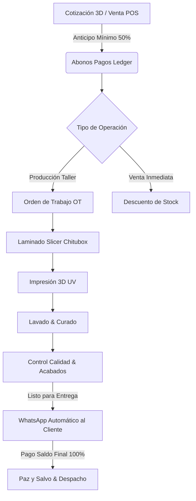

# 🪐 WJGEEKS 3D PRO — Plataforma Integral de Manufactura, POS & Taller 3D

<div align="center">
  
  <p><strong>Sistema Empresarial de Cotización Paramétrica, Punto de Venta Express (POS), Gestión de Cartera y Deudores, Pipeline de Producción, Trazabilidad STL, Marketing Meta/Instagram y Sincronización en Tiempo Real en la Nube.</strong></p>
  <p>
    <code>Versión 3.0.0 Pro Enterprise</code> • <code>Master Schema v3</code> • <code>Supabase Realtime & Offline-First</code> • <code>Hecho para Taller en Colombia 🇨🇴</code>
  </p>
</div>

---

## 📑 Tabla de Contenidos

1. [Visión General del Sistema](#-visión-general-del-sistema)
2. [Ecosistema de Módulos & Funcionalidades](#-ecosistema-de-módulos--funcionalidades)
   - [1. POS Express (Punto de Venta Rápido con Cámara WebP)](#1-pos-express-punto-de-venta-rápido-con-cámara-webp)
   - [2. Central de Deudores & Cuentas por Cobrar](#2-central-de-deudores--cuentas-por-cobrar)
   - [3. Tarifario Oficial por Centímetros ($10.000 / cm)](#3-tarifario-oficial-por-centímetros-10000--cm)
   - [4. Trazabilidad STL & Handoff de Taller (Germán ➔ Juan)](#4-trazabilidad-stl--handoff-de-taller-germán--juan)
   - [5. Cotizador Paramétrico 3D de Alta Precisión](#5-cotizador-paramétrico-3d-de-alta-precisión)
   - [6. Pipeline de Producción & Taller (Órdenes de Trabajo OT)](#6-pipeline-de-producción--taller-órdenes-de-trabajo-ot)
   - [7. Escudo de Privacidad de Seguimiento para Clientes](#7-escudo-de-privacidad-de-seguimiento-para-clientes)
   - [8. Equipo, Tareas & Rutinas de Mantenimiento](#8-equipo-tareas--rutinas-de-mantenimiento)
   - [9. S.O.S Insumos de Taller (Despacho de Compras Express)](#9-sos-insumos-de-taller-despacho-de-compras-express)
   - [10. Marketing Hub & Catálogo Meta Commerce (Instagram / WhatsApp)](#10-marketing-hub--catálogo-meta-commerce-instagram--whatsapp)
   - [11. Catálogo de Figuras en Stock Inmediato](#11-catálogo-de-figuras-en-stock-inmediato)
   - [12. Balance Contable, Costos & Reportes Financieros](#12-balance-contable-costos--reportes-financieros)
3. [Seguridad, Autenticación y Control de Sesión (v3.0)](#-seguridad-autenticación-y-control-de-sesión-v30)
   - [3.1 Claves Flexibles: PIN Rápido o Contraseña Compleja](#31-claves-flexibles-pin-rápido-o-contraseña-compleja)
   - [3.2 Blindaje del Encabezado (Header Minimalista) y Logout Seguro](#32-blindaje-del-encabezado-header-minimalista-y-logout-seguro)
   - [3.3 Resiliencia Multi-Dispositivo y Prevención de Errores UUID (Anti-22P02)](#33-resiliencia-multi-dispositivo-y-prevención-de-errores-uuid-anti-22p02)
   - [3.4 Procedimientos de Recuperación y Gestión en PersonalView](#34-procedimientos-de-recuperación-y-gestión-en-personalview)
4. [Manual Operativo por Roles](#-manual-operativo-por-roles)
5. [Arquitectura Tecnológica & Base de Datos (Supabase Master v3)](#-arquitectura-tecnológica--base-de-datos-supabase-master-v3)
   - [Vistas Canónicas con Security Invoker (Supabase Linter 0010)](#vistas-canónicas-con-security-invoker-supabase-linter-0010)
   - [Catálogo de Tablas del Ledger](#catálogo-de-tablas-del-ledger)
6. [Flujos de Trabajo del Negocio (Workflows)](#-flujos-de-trabajo-del-negocio-workflows)
7. [Instalación Local, Variables de Entorno & PWA](#-instalación-local-variables-de-entorno--pwa)
8. [Respaldo, Google Sheets & Sincronización en Drive](#-respaldo-google-sheets--sincronización-en-drive)

---

## 🎯 Visión General del Sistema

**WJGEEKS 3D PRO** es una solución empresarial de vanguardia desarrollada a la medida para talleres de manufactura aditiva y figuras de colección en resina UV de alta definición (8K).

El sistema resuelve la complejidad operativa real del taller:
- Permite vender figuras de mostrador en **10 segundos** capturando una fotografía comprimida en WebP.
- Controla el 100% de la cartera de clientes, anticipos, abonos sucesivos y fechas prometidas de pago.
- Presupuesta proyectos en 3 segundos según su altura ($10.000 / cm) o con el motor paramétrico de 20 variables.
- Coordina el paso de archivos 3D de modelado a impresión sin pérdidas de archivos ni discrepancias de versión.
- Emite enlaces de seguimiento protegidos y confidenciales para clientes.
- Administra el personal del taller con control de acceso por roles (RBAC), sesiones blindadas y claves flexibles.

---

## 🧩 Ecosistema de Módulos & Funcionalidades

### 1. POS Express (Punto de Venta Rápido con Cámara WebP)
Diseñado para ferias, eventos o ventas directas de figuras en mostrador:
- **Disparo Fotográfico Directo:** Captura directa con cámara web o móvil con compresión automática a formato **WebP** en el navegador para ahorrar ancho de banda y almacenamiento.
- **Botones de Monto Rápido:** Chips de un toque para montos habituales ($50k, $70k, $80k, $100k, $120k).
- **Control de Abonos y Saldo:** Registro del anticipo entregado (Nequi, Bre-B, Daviplata, Efectivo) con cálculo automático de saldo pendiente.
- **Recibo Digital para WhatsApp:** Genera instantáneamente el comprobante formateado con emojis y desglose para enviarlo al cliente en 1 clic.

### 2. Central de Deudores & Cuentas por Cobrar
Unifica en una sola vista toda la cartera del negocio, consolidando ventas de mostrador y cotizaciones:
- **Vista de Deudores Consolidados:** Agrupa todas las deudas por persona con cálculo del saldo total acumulado.
- **Semáforo Inteligente de Alertas de Pago:**
  - 🔴 **Vencido:** Días de mora transcurridos.
  - 🟡 **Paga Hoy:** Clientes con compromiso para la fecha en curso.
  - 🔵 **Próximo al Pago:** Vencimientos en los próximos 1 a 3 días.
  - 🟢 **Al Día / Pagado Total:** Compromisos saldados.
- **Cobro Asistido por WhatsApp:** Plantilla de cobro amigable generada con 1 clic.

### 3. Tarifario Oficial por Centímetros ($10.000 / cm)
Tabla oficial estandarizada para figuras coleccionables en resina UV de 8K:

| Altura de Pieza | Precio Oficial (COP) | Tiempo Estimado de Taller |
| :---: | :---: | :---: |
| **5 cm** | **$50.000** | 3 Días hábiles |
| **6 cm** | **$60.000** | 3 Días hábiles |
| **7 cm** | **$70.000** | 3 Días hábiles |
| **8 cm** | **$80.000** | 3 Días hábiles |
| **9 cm** | **$90.000** | 5 Días hábiles |
| **10 cm** | **$100.000** | 5 Días hábiles |
| **11 cm** | **$110.000** | 7 Días hábiles |
| **12 cm** | **$120.000** | 7 Días hábiles |

### 4. Trazabilidad STL & Handoff de Taller (Germán ➔ Juan)
- **Ciclo de Estados:** *Modelado Pendiente ➔ Diseñado por Germán ➔ Laminado por Juan ➔ En Impresora ➔ Impreso*.
- **Control de Versiones:** Registro de versión de malla (`v1.0`, `v1.1`, `v2.0-ahuecado`).
- **Enlace de Descarga Digital:** Conexión con Google Drive, WeTransfer o nube técnica.

### 5. Cotizador Paramétrico 3D de Alta Precisión
Motor de cálculo técnico de costos reales de producción:
- Gramos de resina UV consumidos y volumen en cm³.
- Depreciación de pantallas LCD, película FEP y fuentes de luz UV.
- Desgaste de insumos de lavado (alcohol isopropílico) y curado UV.
- Mano de obra técnica de post-procesado, soporteo y lijado.
- Márgenes de utilidad comercial y cálculo de anticipo mínimo del 50%.

### 6. Pipeline de Producción & Taller (Órdenes de Trabajo OT)
Tablero Kanban interactivo para el control físico de piezas en taller:
- Transiciones de estado auditadas con fecha y operario responsable.
- Registro de parámetros de máquina: altura de capa (micras), tiempo de exposición y resina utilizada.
- Notificaciones automáticas de cambio de estado.

### 7. Escudo de Privacidad de Seguimiento para Clientes
Portal público aislado (`/?ot=OT-XXXX&token=uuid`):
- Estrictamente de **solo lectura**.
- Oculta costos internos, márgenes y paneles de administración.
- Muestra el progreso de fabricación en 6 fases con garantía de 100% de cumplimiento al liquidar saldo.

---

## 🔐 Seguridad, Autenticación y Control de Sesión (v3.0)

### 3.1 Claves Flexibles: PIN Rápido o Contraseña Compleja
A partir de la versión 3.0, el personal puede utilizar cualquiera de las dos modalidades de acceso:
- **PIN Numérico Rápido (4+ dígitos):** Diseñado para ingreso veloz en tablets o dispositivos del taller.
- **Contraseña Alfanumérica Compleja:** Admite letras mayúsculas, minúsculas, números y símbolos especiales de cualquier longitud.
- **Esquema de Almacenamiento:** La columna `pin_acceso` en `usuarios_taller` fue ampliada a tipo `TEXT`, complementada con `password_hash` y `pin_hash` mediante hashes criptográficos **SHA-256**.
- **Componentes Asociados:**
  - [`CambiarPinModal.tsx`](file:///d:/WJG/src/components/auth/CambiarPinModal.tsx): Modal interactivo con badge dinámico en tiempo real (*PIN Rápido* vs *Contraseña Alfanumérica*).
  - [`PasswordResetModal.tsx`](file:///d:/WJG/src/components/auth/PasswordResetModal.tsx): Restablecimiento seguro mediante WhatsApp OTP.
  - [`MustChangePasswordModal.tsx`](file:///d:/WJG/src/components/auth/MustChangePasswordModal.tsx): Forzado de cambio en primer inicio de sesión.

### 3.2 Blindaje del Encabezado (Header Minimalista) y Logout Seguro
- **Eliminación del Conmutador de Desarrollo:** Se retiró el atajo no autenticado que alternaba entre Juan, Wendy y Germán al hacer clic en la barra superior.
- **Badge Informativo:** El nombre del operador activo es de solo lectura y refleja exactamente la sesión autenticada (`activeOperator === staffUser`).
- **Botón de Cerrar Sesión (`LogOut`):** Ubicado en el encabezado. Revoca la sesión local y el dispositivo de confianza, redirigiendo obligatoriamente a [`StaffAuthGuard.tsx`](file:///d:/WJG/src/components/auth/StaffAuthGuard.tsx) para que el siguiente usuario deba ingresar su PIN o clave.
- **Botón de Cambio de Clave (`KeyRound`):** Acceso directo para que el operador activo actualice sus propias credenciales.

### 3.3 Resiliencia Multi-Dispositivo y Prevención de Errores UUID (Anti-22P02)
- En dispositivos móviles o pestañas de incógnito, los perfiles utilizan los UUIDs canónicos oficiales de Supabase:
  - **Germán:** `08c6c49a-0422-414b-813e-8f58fa651bd5`
  - **Wendy:** `4485aa21-3896-4510-b693-fc68e947372d`
  - **Juan:** `a48df7ca-8b06-4bab-bfa4-3b058912b06f`
- La consulta SQL en `StaffAuthGuard` valida con `isUUID()` antes de construir condiciones `id.eq.<val>`, eliminando por completo el error de PostgreSQL `ERROR 22P02: invalid input syntax for type uuid`.
- Hidratación instantánea del caché local (`wjg_usuarios_taller_cache`) para permitir acceso offline en el celular del taller.

### 3.4 Procedimientos de Recuperación y Gestión en PersonalView
- **Recuperación por Cédula y Teléfono:** Permite a cualquier miembro restablecer su acceso validando su cédula y línea corporativa registrada en `usuarios_taller`.
- **Panel Administrativo [`PersonalView.tsx`](file:///d:/WJG/src/components/personal/PersonalView.tsx):**
  - Creación y edición de colaboradores con selector de áreas RBAC (`ventas`, `taller`, `finanzas`, `gestion`).
  - Campo de contraseña con conmutador de visibilidad (`Eye`/`EyeOff`).
  - Botón de despacho de credenciales de bienvenida formateado para WhatsApp.
  - Kill Switch para suspender accesos de inmediato.

---

## 👥 Manual Operativo por Roles

| Operador | Rol del Sistema | Responsabilidades Clave |
| :--- | :--- | :--- |
| **Germán Reyes** | `ADMIN_COBRANZAS` (Director Global) | Modelado 3D, presupuestos formales, control de tarifarios, cierres contables y administración de accesos. |
| **Wendy Castro** | `PINTURA_ACABADOS` (Cobranzas & Post) | Seguimiento de cartera, conciliación de pagos (Bre-B/Nequi), compras de insumos y acabado artesanal. |
| **Juan David Guzmán** | `IMPRESION_MANTENIMIENTO` (Taller 3D) | Preparación de archivos en Slicer, calibración de impresoras, curado UV, mantenimiento FEP y control de resinas. |

---

## 🏗️ Arquitectura Tecnológica & Base de Datos (Supabase Master v3)

### Vistas Canónicas con Security Invoker (Supabase Linter 0010)
Para cumplir con las directrices de seguridad de PostgreSQL 15+ y resolver las advertencias del auditor de Supabase (`0010_security_definer_view`), las vistas canónicas están declaradas con **`WITH (security_invoker = true)`**:
- `public.vista_balance_taller`: Sumatoria consolidada de recaudos y cartera pendiente.
- `public.payments`: Libro consolidado de abonos y comprobantes.
- `public.cuentas_cobro`: Vista de compromisos comerciales.

```sql
ALTER VIEW public.vista_balance_taller SET (security_invoker = true);
ALTER VIEW public.payments SET (security_invoker = true);
ALTER VIEW public.cuentas_cobro SET (security_invoker = true);
```

### Catálogo de Tablas del Ledger
1. `usuarios_taller`: Directorio oficial de personal, credenciales (`pin_acceso TEXT`, `password_hash`), roles y permisos RBAC.
2. `clientes`: Directorio unificado de clientes y teléfonos.
3. `cotizaciones` & `cotizacion_items`: Historial de presupuestos paramétricos con columnas calculadas de saldo.
4. `ordenes_trabajo` & `historial_estados_ot`: Pipeline de manufactura física en taller.
5. `abonos_pagos`: Ledger contable inmutable de anticipos y liquidaciones con trazabilidad a POS y cotizaciones.
6. `ventas_express`: Punto de venta de mostrador con soporte de imagen WebP.
7. `productos_stock`: Inventario físico de piezas terminadas con alerta de stock crítico.
8. `tareas_equipo` & `tarea_avances`: Bitácora técnica y tablero Kanban de tareas operativas.

---

## 🔄 Flujos de Trabajo del Negocio (Workflows)



1. **Flujo de Producción:** Cotización ➔ Anticipo 50% ➔ Creación atómica de OT y Cuenta de Cobro ➔ Fabricación en Taller ➔ Notificación desatendida por WhatsApp ➔ Liquidación y entrega.
2. **Flujo de Seguridad de Sesión:** Ingreso autenticado en `StaffAuthGuard` ➔ Sincronización de `activeOperator` ➔ Acceso según RBAC ➔ Cierre de sesión explícito mediante botón `LogOut` ➔ Obligatoriedad de credenciales para el siguiente usuario.

---

## 💻 Instalación Local, Variables de Entorno & PWA

### Requisitos Previos
- **Node.js** v18.0.0 o superior
- **npm** v9.0.0 o superior

### Variables de Entorno Requeridas (`.env`)
Crear un archivo `.env` en la raíz del proyecto:

```env
VITE_SUPABASE_URL=https://tu-proyecto.supabase.co
VITE_SUPABASE_ANON_KEY=tu-anon-key-de-supabase
```

### Comandos de Ejecución y Validación
```bash
# 1. Instalar dependencias
npm install

# 2. Iniciar servidor de desarrollo
npm run dev

# 3. Ejecutar suite de pruebas unitarias (Vitest)
npm test

# 4. Compilar para producción (TypeScript estricto + Vite build)
npm run build
```

---

## 💾 Respaldo, Google Sheets & Sincronización en Drive

- **Sincronización Dual:** Copia de respaldo automática hacia Google Sheets vía Google Apps Script ([scripts/google_apps_script.js](scripts/google_apps_script.js)).
- **Respaldo JSON Inmediato:** Exportación completa de todos los módulos mediante Web Share API o descarga de archivo cifrado.

---

<div align="center">
  <p><strong>WJGEEKS 3D PRO — Excelencia en Manufactura Aditiva & Coleccionables</strong></p>
  <p>Línea Oficial de Atención y Ventas: <code>+57 320 279 6115</code> • Bogotá D.C., Colombia</p>
</div>
