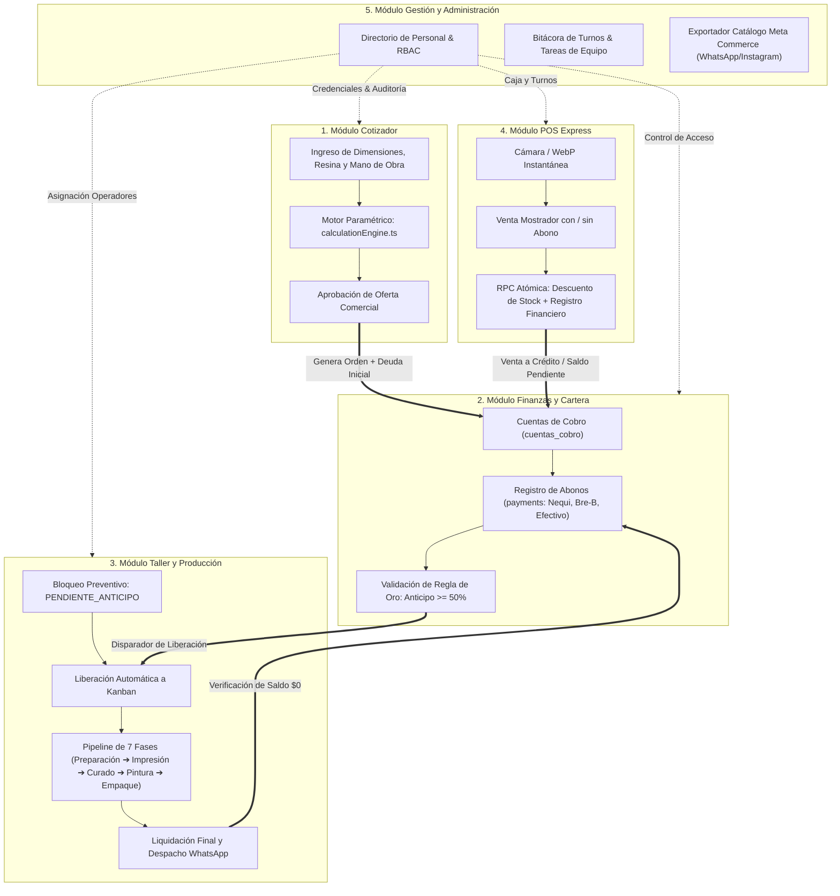
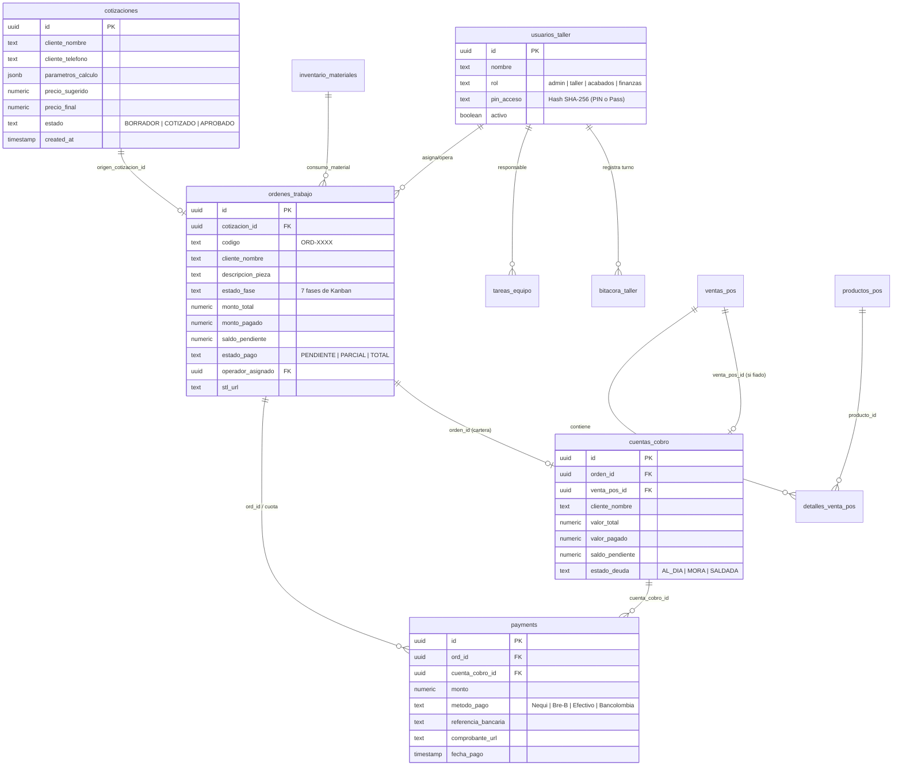

# WJGEEKS 3D PRO — Ecosistema y Arquitectura de Relación Intermodular
**Versión del Documento:** 3.0 Enterprise  
**Sistema:** WJGEEKS 3D PRO (Gestión Operativa, Financiera, Taller y POS)  
**Autor:** Equipo de Arquitectura de Software WJGEEKS  
**Fecha:** Octubre 2026  

---

## 1. Visión General del Ecosistema Operativo

**WJGEEKS 3D PRO** es un ERP / MES (*Manufacturing Execution System*) especializado en manufactura aditiva (impresión 3D en resina y filamento), post-procesado químico, pintura artística y comercialización física omnicanal.

A diferencia de un software contable tradicional o una hoja de cálculo aislada, el sistema opera bajo un **modelo de ciclo de vida unificado y dirigido por eventos** (*Event-Driven Unified Lifecycle*). Cada acción en un módulo repercute en tiempo real sobre los demás:

---

## 2. Mapa Relacional de la Base de Datos (Supabase PostgreSQL)

La consistencia transaccional se garantiza a través del modelo relacional en PostgreSQL alojado en Supabase. A continuación se detalla la matriz de tablas maestras y sus llaves foráneas:

---

## 3. Matriz de Estados y Ciclo de Vida de una Pieza 3D

El sistema garantiza que ninguna pieza comience su impresión física sin respaldo financiero registrado.

| Estado Origen | Evento Disparador | Acción del Sistema | Estado Destino | Responsable |
| :--- | :--- | :--- | :--- | :--- |
| **Borrador (Cotizador)** | Operador ingresa dimensiones (XYZ), resina, horas y margen | [`calculationEngine.ts`](file:///d:/WJG/src/services/calculationEngine.ts) calcula costo base y precio retail | **Cotizado** | Germán / Mostrador |
| **Cotizado** | Cliente acepta la cotización vía WhatsApp | Se inserta registro en `ordenes_trabajo` y `cuentas_cobro` | **Pendiente Anticipo** | Germán / Wendy |
| **Pendiente Anticipo** | Cliente transfiere $\ge 50\%$ por Nequi/Bre-B/Efectivo | Registro en `payments`. Se recalcula `monto_pagado` y `saldo_pendiente` | **En Preparación (Kanban Taller)** | Wendy (Finanzas) |
| **En Preparación** | Germán valida STL, soportes y orientación en Chitubox | Sube archivo preparado o asigna tarea a Juan | **Imprimiendo** | Germán / Juan |
| **Imprimiendo** | Termina ciclo de capas en impresora Photon/Saturn | Operador traslada plataforma a canasta de lavado | **Lavado y Curado** | Juan (Taller) |
| **Lavado y Curado** | 10 min alcohol isopropílico + 5 min cámara UV | Pieza desoldada de soportes e inspeccionada | **Pintura y Acabado** | Juan ➔ Wendy |
| **Pintura y Acabado** | Imprimación, aerografía, sombreado y laca mate/brillante | Se toma foto del resultado final para el cliente | **Control de Calidad** | Wendy |
| **Control de Calidad** | Verificación de tolerancias dimensionales y sin fisuras | Se marca empaque seguro listo | **Listo para Entrega** | Juan / Wendy |
| **Listo para Entrega** | Cliente llega a retirar o se prepara envío mensajería | Validación de Saldo: si `saldo_pendiente > 0`, solicita pago final | **Entregado (Cerrada)** | Mostrador / Germán |

---

## 4. Gobernanza Financiera: Consistencia de Saldos y Auditoría

Para evitar discrepancias entre lo que el taller cree que el cliente pagó y el saldo real en banco, WJGEEKS 3D PRO utiliza una **estrategia de tres capas**:

1. **Tabla `payments` como Fuente Única de Verdad (`Single Source of Truth`)**:  
   Cada centavo recibido se almacena con `monto`, `metodo_pago`, `fecha` y `referencia_bancaria`. Ningún saldo se sobrescribe manualmente; siempre es la sumatoria de sus abonos.
2. **Vista Canónica `vista_balance_taller` con `security_invoker = true`**:  
   Calcula en tiempo real la sumatoria de pagos por cada orden y deduce el `saldo_pendiente`, respetando las políticas de seguridad RLS del usuario que consulta.
3. **RPC de Limpieza Atómica `eliminar_abonos_duplicados()`**:  
   Previene y remueve dobles pagos generados accidentalmente si el usuario hace clic repetido en conexiones lentas, preservando la integridad del balance.

---

## 5. Matriz de Roles y Responsabilidades (RBAC Operativo)

| Operador | Rol de Sistema | Módulos Autorizados | Responsabilidad Operativa Principal |
| :--- | :--- | :--- | :--- |
| **Germán** | `admin` | **Total (5 Módulos)** | Supervisión general, cotizaciones complejas, validación de mallas 3D/STL, administración de usuarios y configuración paramétrica. |
| **Wendy** | `finanzas` / `acabados` | **Finanzas, Cartera, Acabados, POS** | Conciliación de cuentas de cobro, verificación de transferencias Nequi/Bre-B, pintura artística, posprocesado fino y atención POS. |
| **Juan** | `taller` | **Taller, Insumos, Bitácora** | Nivelación de máquinas, preparación de resinas, control del proceso de impresión UV, lavado con IPA, curado y bitácora técnica de fallas. |

---

## 6. Enlaces a los Manuales Específicos

Para consultar los manuales operativos detallados de cada área, refiérase a los siguientes documentos:
- [01. Manual del Cotizador y Motor de Cálculos](file:///d:/WJG/docs/01_MANUAL_COTIZADOR_Y_CALCULOS.md)
- [02. Manual del POS Express y Venta Mostrador](file:///d:/WJG/docs/02_MANUAL_POS_EXPRESS.md)
- [03. Manual del Taller y Flujo de Producción Kanban](file:///d:/WJG/docs/03_MANUAL_TALLER_Y_PRODUCCION.md)
- [04. Manual de Finanzas, Cartera y Conciliación](file:///d:/WJG/docs/04_MANUAL_FINANZAS_Y_CARTERA.md)
- [05. Manual de Gestión, Personal y Administración](file:///d:/WJG/docs/05_MANUAL_GESTION_Y_ADMINISTRACION.md)
- [Manual Maestro Consolidado de Usuario](file:///d:/WJG/docs/MANUAL_DE_USUARIO.md)
