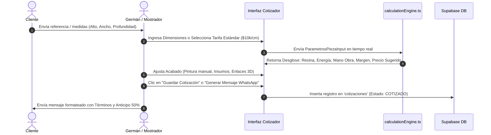

# WJGEEKS 3D PRO — Manual del Cotizador y Motor de Cálculos
**Versión del Documento:** 3.0 Enterprise  
**Módulo:** Cotizaciones, Tarifarios y Motor de Costos Paramétricos  
**Archivos Fuente Principales:** [`src/services/calculationEngine.ts`](file:///d:/WJG/src/services/calculationEngine.ts) | [`src/features/cotizador/utils/pricingCalculator.ts`](file:///d:/WJG/src/features/cotizador/utils/pricingCalculator.ts) | [`src/features/cotizador/hooks/useCotizadorForm.ts`](file:///d:/WJG/src/features/cotizador/hooks/useCotizadorForm.ts)  
**Fecha:** Octubre 2026  

---

## 1. Propósito y Filosofía del Cotizador

El módulo **Cotizador 3D** de WJGEEKS 3D PRO transforma especificaciones técnicas (dimensiones, tipo de resina, tiempos de post-procesado, acabados artísticos y consumo de maquinaria) en una propuesta comercial financieramente viable, protegiendo el margen de ganancia del taller mediante el cálculo exhaustivo de costos directos e indirectos.

El motor erradica el "cálculo a ojo" o tarifas empíricas que con frecuencia subestiman:
1. La merma real de soportes en impresión de resina (hasta un 40% del material impreso).
2. El costo oculto del alcohol isopropílico (IPA) y reactivos de lavado químico.
3. El desgaste acumulativo de la pantalla LCD monocromática y lámina FEP.
4. El consumo eléctrico simultáneo de impresoras, estaciones de curado y compresores de aerografía.
5. El valor/minuto de la mano de obra especializada en modelado y pintura artística.

---

## 2. Flujo Operativo Paso a Paso



### Paso 1: Recepción y Clasificación de la Solicitud
1. El cliente contacta vía WhatsApp, Instagram o mostrador con un enlace (Thingiverse, Cults3D, Printables) o foto de la figura requerida.
2. Si el modelo 3D aún no está optimizado o no se conocen medidas exactas, el cotizador permite activar el interruptor **"Datos Pendientes / Cotización Preliminar"**, indicándole al cliente que la tarifa final se confirmará al cortar el STL en software 3D.

### Paso 2: Selección del Modo de Tarifación
El operador dispone de dos caminos en la interfaz:
* **Ruta Rápida (Tarifario Estándar por Altura):** Para consultas rápidas de mostrador de figuras proporcionales estándar (anime, réplicas, trofeos).
* **Ruta de Ingeniería Paramétrica (Cálculo Completo):** Para piezas industriales, piezas con bisutería, modelos de gran escala o proyectos con alto detalle de pintura.

### Paso 3: Aprobación Comercial y Compromiso del 50%
Una vez el cliente da luz verde, la cotización se promueve a orden de trabajo. El sistema exige el registro del **anticipo del 50% mínimo** antes de encender cualquier impresora.

---

## 3. Las 20 Variables Paramétricas del Sistema

| # | Variable de Entrada | Unidad | Rango Típico | Impacto en el Costo |
| :--- | :--- | :--- | :--- | :--- |
| **1** | `alto_mm` | mm | $10 - 350\text{ mm}$ | Determina el tiempo de impresión en Z y volumen cúbico. |
| **2** | `ancho_mm` | mm | $10 - 250\text{ mm}$ | Ocupación de cama y volumen de la pieza. |
| **3** | `profundidad_mm` | mm | $10 - 250\text{ mm}$ | Volumen geométrico de resina. |
| **4** | `tipoEstructura` | enum | `solido` o `ahuecado` | Si es ahuecado, aplica un ratio de pared (~0.35) reduciendo drásticamente el peso. |
| **5** | `porcentajeRelleno` | % | $15\% - 100\%$ | Porcentaje de infill si se ahueca la malla. |
| **6** | `pesoResinaManualG` | gramos | $1 - 2500\text{ g}$ | Sobrescribe el cálculo si se slició en Chitubox/Lychee. |
| **7** | `densidad_g_cm3` | $\text{g/cm}^3$ | $1.10 - 1.25$ | Propiedad del material (ej: Anycubic Standard 1.15). |
| **8** | `costo_gramo` | COP / g | $\$130 - \$280$ | Costo de adquisición de la resina por gramo. |
| **9** | `velocidad_impresion_mm_h` | mm / h | $15 - 35\text{ mm/h}$ | Rapidez de fotocurado según capas y altura de capa. |
| **10** | `impresora.costo_minuto` | COP / min | $\$5 - \$15$ | Energía de la impresora + amortización de equipo. |
| **11** | `tiempo_impresion_calc` | minutos | Calculado o Manual | Duración del ciclo en la máquina 3D. |
| **12** | `requiereCurado` | boolean | `true / false` | Activa cámara de lavado y curado UV posterior. |
| **13** | `estacionCurado.costo_minuto` | COP / min | $\approx \$5.004$ | Consumo de la estación Anycubic Wash & Cure. |
| **14** | `insumoCurado.costo_unitario` | COP / g | $\$10.27\text{ COP/g}$ | Consumo y evaporación de alcohol isopropílico. |
| **15** | `requiereCompresorPintura` | boolean | `true / false` | Activa máquina de aire comprimido para aerógrafo. |
| **16** | `tiempoPinturaMin` | minutos | $0 - 600\text{ min}$ | Tiempo del artista en pintura y sombreado. |
| **17** | `tiempoDesarrolloMin` | minutos | $0 - 240\text{ min}$ | Preparación de soportes, cortes y reparación STL. |
| **18** | `tiempoArmadoMin` | minutos | $0 - 180\text{ min}$ | Pegado con cianocrilato, lijado e inserción de pernos. |
| **19** | `accesorios / pinturas / empaques` | COP | Según catálogo | Costos directos de imanes, bases acrílicas, cajas kraft. |
| **20** | `margenGanancia` | decimal | $0.35 - 0.70$ ($35\% - 70\%$) | Margen comercial del taller sobre el costo directo. |

---

## 4. Fórmulas Matemáticas de Costeo (Ingeniería Inversa de Código)

A continuación se presentan las fórmulas exactas ejecutadas en [`src/services/calculationEngine.ts`](file:///d:/WJG/src/services/calculationEngine.ts):

### 4.1. Volumen y Peso Estimado
El volumen teórico en centímetros cúbicos ($1\text{ cm}^3 = 1\text{ ml}$) se calcula como:

$$V_{\text{cm}^3} = \frac{\text{Alto}_{\text{mm}} \times \text{Ancho}_{\text{mm}} \times \text{Profundidad}_{\text{mm}}}{1000}$$

El peso bruto de la pieza ($W_g$) depende del ratio de estructura:

$$W_g = V_{\text{cm}^3} \times \rho_{\text{resina}} \times R_{\text{estructura}}$$

Donde:
* $\rho_{\text{resina}}$ es la densidad (por defecto $1.15\text{ g/cm}^3$).
* $R_{\text{estructura}} = 1.0$ si la pieza es maciza/sólida.
* $R_{\text{estructura}} = \frac{\%\text{ Relleno}}{100}$ (por defecto $0.35$) si es ahuecada.

### 4.2. Tiempo de Impresión 3D
Si el operador no introduce un tiempo manual del slicer:

$$T_{\text{impresion (min)}} = \text{round}\left(\frac{\text{Alto}_{\text{mm}}}{\text{Velocidad}_{\text{mm/h}}} \times 60\right)$$

### 4.3. Costo de Resina con Factor de Merma (Soportes y Residuos)
La manufactura aditiva genera soportes descartables y películas en el FEP. El costo se amplifica con el factor de merma configurado en taller ($1.40$, equivalente al $40\%$ adicional):

$$\text{Costo}_{\text{resina}} = W_g \times \text{Costo}_{\text{gramo}} \times 1.40$$

*(Si se usa modo manual por peso del slicer, el factor es $1.10$, es decir, $10\%$ de merma).*

### 4.4. Curado Químico y Térmico UV
El lavado en alcohol y curado UV consume energía y desgasta solvente:
* **Tiempo de curado ($t_{\text{curado}}$):**
  * Si $W_g \le 50\text{ g} \implies 5\text{ minutos}$.
  * Si $50\text{ g} < W_g < 250\text{ g} \implies 10\text{ minutos}$.
  * Si $W_g \ge 250\text{ g} \implies 15\text{ minutos}$.
* **Insumo químico:** $W_g \times 10.27\text{ COP/g}$.

$$\text{Costo}_{\text{curado}} = (t_{\text{curado}} \times \text{CostoMinuto}_{\text{estacion}}) + (W_g \times 10.27)$$

### 4.5. Energía Eléctrica Total Consolidada
Suma el consumo de todo el parque de máquinas involucradas:

$$\text{Costo}_{\text{energia}} = (T_{\text{imp}} \times C_{\text{imp}}) + (T_{\text{cur}} \times C_{\text{cur}}) + (T_{\text{comp}} \times C_{\text{comp}}) + \sum (T_{\text{extra}_i} \times C_{\text{extra}_i})$$

### 4.6. Mano de Obra Especializada
Con una tarifa estándar de $\$166.67\text{ COP/minuto}$ ($\approx \$10.000\text{ COP/hora}$ de dedicación efectiva):

$$\text{Costo}_{\text{mano\_obra}} = (t_{\text{desarrollo}} + t_{\text{armado}} + t_{\text{pintura}}) \times 166.67$$

### 4.7. Costo Base de Producción
$$\text{Costo Base} = \text{Costo}_{\text{energia}} + \text{Costo}_{\text{resina}} + \text{Costo}_{\text{curado}} + \text{Costo}_{\text{insumos}} + \text{Costo}_{\text{mano\_obra}} + \text{Costo}_{\text{modelo\_3D}}$$

### 4.8. Precio Retail Sugerido y Redondeo a Centenas COP (MROUND)
Para evitar precios con centavos o números fraccionados que compliquen el cobro en efectivo o pasarelas:

$$\text{Precio Unitario} = \text{round}\left(\frac{\text{Costo Base} \times (1 + \text{Margen})}{100}\right) \times 100$$

$$\text{Precio Total} = \text{ceil}\left(\frac{\text{Precio Unitario} \times \text{Cantidad}}{100}\right) \times 100$$

---

## 5. El Tarifario Estándar por Altura ($10.000 COP / cm)

Para agilizar la cotización inmediata cuando el cliente pregunta por WhatsApp *"¿Cuánto me vale una figura de 10 cm?"*, WJGEEKS 3D PRO tiene preconfigurada la **Matriz de Tarifas por Altura**:

| Altura ($cm$) | Dimensiones Simuladas ($XYZ$ en $mm$) | Precio Sugerido COP | Tiempo Estimado de Taller |
| :---: | :---: | :---: | :---: |
| **$5\text{ cm}$** | $50 \times 30 \times 30\text{ mm}$ | **$\$50.000$** | (3) Días hábiles |
| **$6\text{ cm}$** | $60 \times 36 \times 36\text{ mm}$ | **$\$60.000$** | (3) Días hábiles |
| **$7\text{ cm}$** | $70 \times 42 \times 42\text{ mm}$ | **$\$70.000$** | (3) Días hábiles |
| **$8\text{ cm}$** | $80 \times 48 \times 48\text{ mm}$ | **$\$80.000$** | (3) Días hábiles |
| **$9\text{ cm}$** | $90 \times 54 \times 54\text{ mm}$ | **$\$90.000$** | (5) Días hábiles |
| **$10\text{ cm}$** | $100 \times 60 \times 60\text{ mm}$ | **$\$100.000$** | (5) Días hábiles |
| **$11\text{ cm}$** | $110 \times 66 \times 66\text{ mm}$ | **$\$110.000$** | (7) Días hábiles |
| **$12\text{ cm}$** | $120 \times 72 \times 72\text{ mm}$ | **$\$120.000$** | (7) Días hábiles |

> [!TIP]
> Al seleccionar una tarifa de la matriz, el formulario calcula automáticamente la relación de aspecto ($60\%$ de ancho y profundidad respecto al alto) y fija el precio unitario sugerido, permitiendo al operador recalcular el margen real obtenido en caso de que la figura sea inusualmente ancha o pesada.

---

## 6. Generación y Envío de la Oferta por WhatsApp

Al hacer clic en **"Copiar para WhatsApp"**, el sistema genera una plantilla estructurada lista para enviar al cliente:

```text
👾 *COTIZACIÓN WJGEEKS 3D PRO* 👾
Consecutivo: COT-26-075
Cliente: Carlos Méndez

📦 *DETALLE DE LA PIEZA:*
• Ítem: Figura Coleccionable Wolverine
• Dimensiones: 100 x 60 x 60 mm (10 cm de alto)
• Material: Resina UV Alta Definición Gris
• Acabado: Pintura Artística Manual Premium
• Tiempo Estimado de Entrega: (5) Días hábiles

💰 *RESUMEN ECONÓMICO:*
• Valor Unitario: $100.000 COP
• Cantidad: 1 unidad
• Subtotal: $100.000 COP
------------------------------------------
*TOTAL A PAGAR:* $100.000 COP

💳 *CONDICIONES DE PAGO:*
• Anticipo requerido para iniciar producción (50%): $50.000 COP
• Saldo contra entrega: $50.000 COP
• Cuentas autorizadas:
  - Nequi / Bre-B: 310-000-0000
  - Bancolombia Ahorros: 245-000123-98

⚠️ *Nota:* Esta cotización tiene una vigencia de 8 días hábiles.
```

---

## 7. Bloqueo de Producción: Regla del 50% de Anticipo

El sistema implementa en [`pricingCalculator.ts`](file:///d:/WJG/src/features/cotizador/utils/pricingCalculator.ts#L118-L163) la función:
```typescript
validarRegla50Anticipo(total, abono, estadoPago)
```
Si el cliente no transfiere al menos el $50\%$ ($\text{monto} \ge \lceil \text{total} \times 0.5 \rceil$):
1. La orden permanece en el estado preventivo **`PENDIENTE_ANTICIPO`**.
2. No se envía a la bandeja de trabajo de Juan (operador de taller).
3. No se descuenta resina del inventario.
4. El sistema indica con alerta roja en la pantalla de Finanzas la cifra exacta faltante para autorizar el encendido de máquinas.
