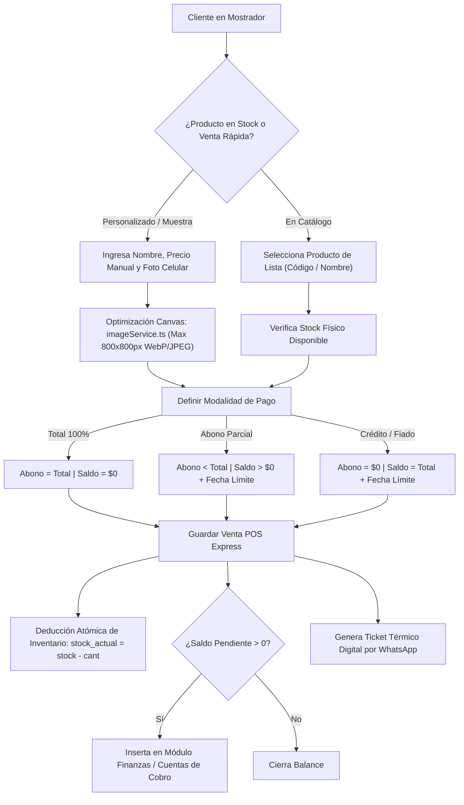

# WJGEEKS 3D PRO — Manual del POS Express y Venta Mostrador
**Versión del Documento:** 3.0 Enterprise  
**Módulo:** Punto de Venta Express, Inventario Físico y Cartera de Mostrador  
**Archivos Fuente Principales:** [`src/components/pos/POSExpressView.tsx`](file:///d:/WJG/src/components/pos/POSExpressView.tsx) | [`src/services/posService.ts`](file:///d:/WJG/src/services/posService.ts) | [`src/services/imageService.ts`](file:///d:/WJG/src/services/imageService.ts) | [`src/services/__tests__/inventoryReconciliation.test.ts`](file:///d:/WJG/src/services/__tests__/inventoryReconciliation.test.ts)  
**Fecha:** Octubre 2026  

---

## 1. Visión y Objetivo del POS Express

El módulo **POS Express** de WJGEEKS 3D PRO está diseñado para la venta ágil en mostrador, eventos geek (SOFA, Comic-Con) y despachos directos de figuras terminadas en stock.

A diferencia del cotizador (que se enfoca en fabricación bajo pedido desde cero), el POS Express permite cerrar transacciones en menos de 30 segundos, soportando tres modalidades críticas de cobro:
1. **Contado Inmediato (100% Pagado):** Efectivo, Bre-B o Nequi en el momento.
2. **Abono Parcial con Saldo Pendiente:** El cliente se lleva la pieza o la aparta con un anticipo, programando una fecha límite de pago.
3. **Crédito Total ("Fiado" con registro de cartera):** El cliente retira la pieza con saldo $0 abonado, generando automáticamente una cuenta por cobrar en el sistema.



---

## 2. Captura y Compresión Inteligente de Imágenes en Cliente

Para evitar que los celulares de alta gama saturen el almacenamiento local o la base de datos Supabase con fotografías de 15 a 25 Megabytes, el sistema incorpora el servicio [`src/services/imageService.ts`](file:///d:/WJG/src/services/imageService.ts):

### Algoritmo de Compresión en Canvas:
1. Lee el archivo mediante `FileReader` o flujo de cámara HTML5.
2. Calcula la relación de aspecto limitando las dimensiones a un máximo de **$800 \times 800\text{ px}$**:
   $$\text{ratio} = \min\left(\frac{800}{\text{width}}, \frac{800}{\text{height}}\right)$$
3. Dibuja sobre un elemento `<canvas>` en memoria con suavizado de bordes bicúbico (`ctx.imageSmoothingQuality = 'high'`).
4. Exporta a formato `image/jpeg` o `image/webp` con factor de calidad del $85\%$ (`quality = 0.85`).
5. **Resultado:** Una imagen de $20\text{ MB}$ se reduce a un payload optimizado de entre $45\text{ KB}$ y $90\text{ KB}$, manteniendo nitidez profesional en la factura y agilizando la sincronización con la nube.

---

## 3. Generación Consecutiva de Recibos (`POS-XXX`)

Para mantener estricta trazabilidad de auditoría de caja, cada venta recibe un identificador secuencial generado por la función:
```typescript
generarConsecutivoPOS(ventasExistentes: VentaExpress[]): string
```
* Examina todas las ventas históricas extrayendo la expresión regular `POS-(\d+)`.
* Identifica el valor entero máximo registrado.
* Incrementa en 1 y formatea con ceros a la izquierda a tres dígitos (ejemplo: `POS-001`, `POS-015`, `POS-142`).

---

## 4. Reconciliación y Protección de Inventario Físico

El sistema asegura la consistencia entre el stock físico del mostrador y los registros digitales mediante dos operaciones complementarias:

### 4.1. Deducción en Venta (`aplicarDeduccionStock`)
Cuando la casilla `descontar_stock` está activa:
```typescript
const nuevoStock = Math.max(0, p.stock_actual - cantidad);
```
* Se descuenta la cantidad vendida del producto vinculado.
* Si el stock llega a 0, el sistema muestra una advertencia visual amarilla en el catálogo de productos para alertar al equipo de taller sobre la necesidad de reimprimir unidades.

### 4.2. Reposición por Anulación o Devolución (`aplicarReposicionStock`)
Si una venta express se cancela o elimina por error de digitación:
```typescript
stock_actual: p.stock_actual + cantidad
```
* El sistema reintegra automáticamente las unidades al inventario físico, evitando fugas o descuadres de stock en auditorías.

---

## 5. Matriz del Semáforo de Cobranza (Cuentas por Cobrar de Mostrador)

Cuando una venta express se pacta a crédito o con abono parcial, el motor [`src/services/posService.ts`](file:///d:/WJG/src/services/posService.ts) activa el **Semáforo Dinámico de Cobranza**:

| Nivel de Alerta | Condición Cronológica | Badge Visual | Acción Operativa Recomendada |
| :--- | :--- | :--- | :--- |
| **`pagado`** | $\text{saldo\_pendiente} \le 0$ | 🟢 Verde (`#34d399`) | Venta saneada. Ninguna acción requerida. |
| **`al_dia`** | Fecha límite mayor a 2 días en el futuro | 🟢 Verde Claro (`#10b981`) | Crédito vigente sin riesgo inminente. |
| **`proximo`** | Faltan entre 1 y 2 días para la fecha acordada | 🔵 Azul Cielo (`#38bdf8`) | Notificación preventiva de cortesía vía WhatsApp. |
| **`hoy`** | $\text{diffDias} == 0$ (Fecha límite es hoy) | 🟡 Ámbar (`#fbbf24`) | Enviar mensaje directo de cobro con llave Bre-B/Nequi. |
| **`vencido`** | $\text{diffDias} < 0$ (Excedió la fecha pactada) | 🔴 Rojo Alerta (`#f87171`) | Gestión prioritaria de cartera; suspensión de nuevos pedidos. |

---

## 6. Consolidación de Deudores (`agruparDeudores`)

Si un cliente habitual ("Juan Pérez") ha adquirido tres figuras diferentes en distintas fechas y tiene saldos pendientes en cada una, el POS Express no lo muestra como tres deudores dispersos, sino que ejecuta la consolidación:
* **Sumatoria de Deuda Total:** $\sum \text{total}$
* **Sumatoria de Abonos:** $\sum \text{abonos}$
* **Saldo Consolidado:** $\sum \text{saldo\_pendiente}$
* **Peor Alerta:** Asigna el color de semáforo más grave entre todas sus compras (si dos están al día pero una está vencida, el deudor se califica en rojo **Vencido**).

---

## 7. Ticket Térmico Digital por WhatsApp

Al registrar la venta, el sistema ofrece el botón **"Enviar Comprobante WhatsApp"**, el cual abre la API directa de WhatsApp (`https://wa.me/...`) con el comprobante preformateado:

```text
👋 ¡Hola *Santiago Gómez*! 🎨📦
Te compartimos el comprobante de tu compra en *WJGEEKS 3D*:

🏷️ *Recibo N°:* POS-048
🛠️ *Figura / Producto:* Busto Batman Arkham 15cm
📅 *Fecha:* 2026-10-23

━━━━━━━━━━━━━━━━━━━━
💵 *Total:* $65.000 COP
✅ *Abonado:* $30.000 COP
⏳ *SALDO PENDIENTE:* $35.000 COP
━━━━━━━━━━━━━━━━━━━━

📌 *Fecha límite acordada:* 2026-10-30 (Al día en 7 días)

💳 *Medios de Pago Oficiales:*
• *Bre-B (Llave única):* 0090778625
• *Nequi:* 310-000-0000 (WJGEEKS 3D)

Por favor envíanos tu soporte una vez realizado el pago. ¡Gracias por apoyar nuestro taller! ✨🚀
```
