# WJGEEKS 3D PRO — Manual de Taller y Flujo de Producción Kanban
**Versión del Documento:** 3.0 Enterprise  
**Módulo:** Taller, Órdenes de Trabajo (OT), Trazabilidad STL y Pipeline de Manufactura  
**Archivos Fuente Principales:** [`src/features/workshop/index.tsx`](file:///d:/WJG/src/features/workshop/index.tsx) | [`src/features/workshop/utils/workshopUtils.ts`](file:///d:/WJG/src/features/workshop/utils/workshopUtils.ts) | [`src/features/workshop/hooks/useTallerOrders.ts`](file:///d:/WJG/src/features/workshop/hooks/useTallerOrders.ts)  
**Fecha:** Octubre 2026  

---

## 1. Visión y Función del MES de Taller

El módulo de **Taller y Producción** opera como el *Manufacturing Execution System (MES)* de WJGEEKS 3D. Controla la transformación física de resinas fotosensibles e insumos artísticos en esculturas y piezas de ingeniería terminadas.

El sistema garantiza que ninguna máquina comience a consumir recursos sin una orden autorizada y que cada relevo de turno entre los operadores (**Germán**, **Juan** y **Wendy**) ocurra con instrucciones técnicas claras, enlaces de mallas 3D accesibles y trazabilidad de tiempos.

```mermaid
flowchart LR
    G0["Gate 0: Pendiente Anticipo"] -->|Anticipo >= 50%| S1["1. En Cola\n(Preparación STL)"]
    S1 -->|Handoff a Juan| S2["2. Imprimiendo\n(Fotocurado UV)"]
    S2 -->|Aviso Lavado| S3["3. Curado\n(IPA + Cámara UV)"]
    S3 -->|Handoff a Wendy| S4["4. Pintura & Armado\n(Aerografía / Ensamble)"]
    S4 -->|Inspección Tripartita| S5["5. Control de Calidad\n(Tolerancias & Acabado)"]
    S5 -->|Handoff a Germán| S6["6. Listo para Entrega\n(Cobro Saldo & Despacho)"]
    S6 -->|Retiro / Envío| S7["7. Entregado\n(Orden Cerrada)"]
```



---

## 2. El Pipeline Kanban de 7 Fases

El tablero Kanban (`WorkOrdersPipeline.tsx`) organiza las órdenes en columnas interactivas optimizadas tanto para escritorio como para dispositivos móviles táctiles:

### Gate 0: Bloqueo Preventivo `PENDIENTE_ANTICIPO`
* **Causa:** Cotización aprobada por el cliente pero con abono $< 50\%$.
* **Efecto en Taller:** La orden no aparece en el flujo de trabajo activo de Juan. Esto previene que se inviertan horas de impresión y resina costosa en clientes que cancelan a último momento.

### Fase 1: `En Cola` (Preparación Técnica y Laminado)
* **Responsable:** Germán / Juan.
* **Actividades:**
  * Descarga o modelado de la malla 3D desde repositorios autorizados (Cults3D, Thingiverse, Printables).
  * Orientación para minimizar succión en el FEP y optimizar el detalle facial.
  * Colocación de soportes pesados, medianos y ligeros en Chitubox / Lychee Slicer.
  * Ahuecado (*Hollowing*) e inserción de orificios de drenaje para evitar bolsas de resina líquida.

### Fase 2: `Imprimiendo` (Fotocurado en Máquina)
* **Responsable:** Juan (Operador de Maquinaria).
* **Actividades:**
  * Verificación del nivelado y tensión de la lámina FEP en la tina.
  * Batido homogéneo y vertido de resina Anycubic / Elegoo a temperatura ambiente ($22^\circ\text{C} - 26^\circ\text{C}$).
  * Inicio del ciclo de fotopolimerización capa por capa.
  * Monitoreo de las primeras 5 capas de adhesión a la placa de construcción (*Bottom Layers*).

### Fase 3: `Curado` (Lavado Químico y Post-Curado UV)
* **Responsable:** Juan.
* **Actividades:**
  * Despegue cuidadoso de la plataforma mediante espátula metálica angulada.
  * Inmersión en canasta de alcohol isopropílico (IPA $\ge 96\%$) durante 5 a 10 minutos para disolver resina residual.
  * Remoción de soportes en caliente (o con alicate de corte raso para no dejar marcas profundas).
  * Exposición en cámara giratoria UV a $405\text{ nm}$ entre 5 y 15 minutos según masa de la pieza.

### Fase 4: `Pintura y Armado` (Taller de Arte y Ensamble)
* **Responsable:** Wendy.
* **Actividades:**
  * Lijado fino al agua (granos 400 ➔ 800) e imprimación con primer acrílico gris o negro.
  * Ensamble estructural con cianocrilato de alta densidad y pernos de latón si la estatua viene seccionada.
  * Aplicación de base con aerógrafo, sombreado cenital (*zenithal shading*), pincel seco y detalles faciales a mano alzada.
  * Sellado con barniz protector acrílico mate o satinado contra fricción y rayos UV.

### Fase 5: `Control de Calidad` (Auditoría Tripartita)
* **Responsables:** Equipo Tripartito (Germán, Juan, Wendy).
* **Actividades:**
  * Revisión con lupa y luz rasante: ausencia de fisuras por gases internos, sin marcas de soporte evidentes y colores fieles a la referencia del cliente.
  * Validación dimensional con pie de rey.

### Fase 6: `Listo para Entrega` (Empaque y Despacho)
* **Responsables:** Germán / Wendy.
* **Actividades:**
  * Envoltorio protector con plástico de burbuja de alta densidad o caja kraft sellada.
  * Notificación automática por WhatsApp al cliente informando que el pedido puede ser retirado o despachado con motorizado.
  * **Comprobación Financiera:** Si la orden tiene saldo pendiente, se exige el comprobante antes de entregar el paquete físico.

---

## 3. Matriz de Relevo Operativo (Handoff por WhatsApp)

Cada cambio de columna en el Kanban ofrece el botón de **"Handoff Instantáneo"**, que redacta el mensaje formal en WhatsApp con el rol del siguiente operador:

| Estado Actual | Destinatario del Handoff | Teléfono Oficial | Acción Requerida |
| :--- | :--- | :--- | :--- |
| **`En Cola`** | **Juan (Impresión)** | `+57 321 7273025` | Notifica para cargar archivo en USB, nivelar máquina e iniciar impresión. |
| **`Imprimiendo`** | **Juan (Curado)** | `+57 321 7273025` | Alerta de fin de ciclo para lavado con alcohol y curado UV. |
| **`Curado`** | **Wendy (Pintura)** | `+57 320 4814702` | Traslada la pieza seca a la estación de aerografía y acabados. |
| **`Pintura y Armado`**| **Equipo Tripartito** | `+57 350 3443140` | Convoca a Germán, Juan y Wendy para inspección de calidad final. |
| **`Control de Calidad`**| **Germán (Cobranzas)**| `+57 350 3443140` | Informa que la pieza superó calidad y autoriza liquidación de saldo. |
| **`Listo para Entrega`**| **Cliente Final** | Celular de la OT | Envía mensaje de retiro con saldo pendiente y medios de pago. |

---

## 4. Trazabilidad de Estados STL (`ModalTrazabilidadSTL`)

Para evitar confusiones sobre la versión de archivo que se está imprimiendo, cada orden cuenta con un micro-estado de ingeniería de software 3D:

```text
[ Modelado Pendiente ] ➔ [ Diseñado por Germán ] ➔ [ Laminado por Juan ] ➔ [ En Impresora ] ➔ [ Impreso ]
```

* **Modelado Pendiente:** El cliente envió una imagen de referencia pero aún no existe archivo digital `.stl` o `.obj`.
* **Diseñado por Germán:** Germán esculpió la pieza en ZBrush o la descargó de un repositorio, verificando que la malla sea estanca (*manifold* / sin aristas abiertas).
* **Laminado por Juan:** Juan generó el archivo de rebanado `.ctb` o `.goo` configurando tiempos de exposición para la resina elegida.
* **En Impresora:** El archivo está cargado y ejecutándose en la máquina asignada.
* **Impreso:** El archivo físico existe y superó con éxito la plataforma de adhesión.

---

## 5. Proyectos Rápidos (`ModalProyectoRapido`)

Cuando un cliente llega al taller con una necesidad urgente o un pedido express:
1. El operador pulsa el botón superior **"➕ Proyecto Rápido"**.
2. Puede asociar directamente una **Tarifa Estándar por Tamaño** ($10.000 COP / cm) o fijar un precio personalizado.
3. Permite registrar un anticipo inmediato y generar la orden de trabajo en un solo paso, vinculándola opcionalmente a un cobro POS Express en mostrador.

---

## 6. Enlaces de Referencia de Compra y Modelos 3D (`ModalEditarEnlacesOT`)

Cada tarjeta de orden de trabajo permite adjuntar y previsualizar enlaces externos con detección automática de plataforma:
* 🌐 **Cults3D**
* 🌐 **Thingiverse**
* 🌐 **Printables (Prusa)**
* 🌐 **MakerWorld (Bambu Lab)**
* 🌐 **CGTrader**
* 🌐 **ArtStation Marketplace**

El sistema detecta automáticamente la plataforma a partir de la URL y permite registrar el **costo estimado de adquisición de la licencia 3D**, integrándolo directamente al costo base de producción.

---

## 7. Mantenimiento Preventivo y "SOS Insumos"

El taller cuenta con el protocolo de emergencia **SOS Insumos** (`solicitudes_insumos`):
* Cuando un operador detecta que el alcohol isopropílico está saturado de resina, o que una lámina FEP presenta hendiduras que amenazan con perforación, registra una solicitud con nivel de prioridad (**URGENTE / ALTO / NORMAL**).
* Germán y Wendy reciben la notificación para autorizar la compra con caja menor antes de que la línea de producción se detenga.
