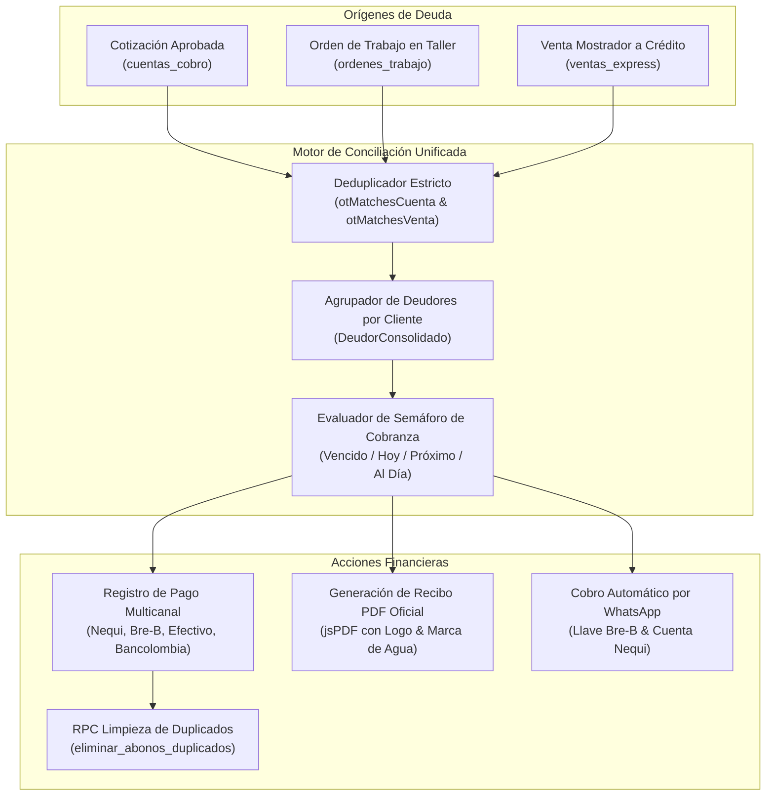

# WJGEEKS 3D PRO — Manual de Finanzas, Cartera y Conciliación
**Versión del Documento:** 3.0 Enterprise  
**Módulo:** Finanzas, Cuentas de Cobro, Conciliación de Pagos y Auditoría de Saldos  
**Archivos Fuente Principales:** [`src/components/cuentasCobro/CuentasCobroList.tsx`](file:///d:/WJG/src/components/cuentasCobro/CuentasCobroList.tsx) | [`src/services/pdfService.ts`](file:///d:/WJG/src/services/pdfService.ts) | [`supabase/migrations/20261023000004_fix_security_definer_views.sql`](file:///d:/WJG/supabase/migrations/20261023000004_fix_security_definer_views.sql)  
**Fecha:** Octubre 2026  

---

## 1. Visión y Propósito del Módulo Financiero

El módulo de **Finanzas y Cartera** centraliza todos los flujos de dinero entrantes en WJGEEKS 3D, unificando tres fuentes independientes en un único libro mayor de auditoría:
1. **Cuentas de Cobro de Cotizaciones:** Proyectos formales de fabricación bajo pedido.
2. **Saldos de Órdenes de Trabajo (OT):** Piezas en producción en taller que tienen cuotas pendientes antes de despacho.
3. **Créditos y Abonos Parciales de Mostrador (POS Express):** Ventas directas donde el cliente retiró o apartó una figura con pago diferido.

El principio cardinal del sistema es **cero discrepancia entre el taller y el banco**: ningún pedido se marca como saldado sin su respectivo registro en la tabla transaccional de pagos.



---

## 2. La Central Unificada de Deudores

A diferencia de los sistemas tradicionales que fragmentan la deuda en diferentes pantallas, la vista de Cartera ejecuta en memoria una consolidación inteligente:

### Algoritmo de Vinculación y Deduplicación Estricta:
Para evitar que una misma figura figure como deuda doble (por ejemplo, si existe la Orden `OT-0012` y a su vez se generó la Cuenta de Cobro `CC-0012` vinculada a la cotización `COT-26-075`), el sistema evalúa las funciones de coincidencia estricta:
```typescript
otMatchesCuenta(orden, cuenta)
otMatchesVenta(orden, ventaPOS)
```
Si se detecta coincidencia por ID de cotización, número de documento, o coincidencia cruzada de cliente e ítem, el sistema **fusiona los saldos en un solo ítem consolidado**, garantizando que el total por cobrar refleje la realidad exacta.

### Ficha de Deudor Consolidado:
Cuando un cliente acumula múltiples compras, la tarjeta de deudor presenta:
* **Deuda Total Acumulada:** Sumatoria del valor de todos sus pedidos.
* **Total Abonado Histórico:** Sumatoria de transferencias y pagos en efectivo recibidos.
* **Saldo Neto Pendiente:** Monto exigible al día de hoy.
* **Peor Semáforo:** Si el cliente tiene un pedido al día pero otro vencido hace 5 días, su calificación global se tiñe de **Rojo Alerta**.

---

## 3. Canales Oficiales y Registro de Pagos

El modal **"Registrar Pago"** (`ModalRegistrarPago.tsx`) soporta cuatro vías de recaudo oficiales de WJGEEKS 3D:

| Canal de Recaudo | Identificador en Sistema | Detalle de Operación |
| :--- | :--- | :--- |
| **Bre-B (Llave Única)** | `Bre-B` | Transferencia interbancaria inmediata con la llave oficial `0090778625`. |
| **Nequi** | `Nequi` | Cuenta vinculada al titular oficial de taller. Exige número de aprobación de 6 dígitos. |
| **Efectivo Mostrador** | `Efectivo` | Dinero físico recibido en caja. Se afecta el saldo de caja del turno activo. |
| **Bancolombia** | `Bancolombia` | Transferencia o consignación a Cuenta de Ahorros `245-000123-98`. |

Al ingresar el monto recibido:
1. El sistema deduce el valor del `saldo_pendiente` en tiempo real.
2. Si el saldo llega a $\$0$, el estado se actualiza a **`PAGADO TOTAL`**.
3. Si la orden estaba en espera en el taller, se desbloquea su paso a la siguiente etapa de producción.

---

## 4. Emisión de Cuentas de Cobro en PDF (`pdfService.ts`)

Para clientes corporativos, instituciones o pedidos formales, el sistema incorpora el generador vectorial [`src/services/pdfService.ts`](file:///d:/WJG/src/services/pdfService.ts), el cual compila documentos de estándar tributario colombiano:

### Elementos del Documento Generado:
* **Encabezado Corporativo:** Logotipo de WJGEEKS 3D PRO precargado y vectorizado en Base64 para evitar errores de renderizado en navegadores offline.
* **Datos del Emisor:** Razón social, NIT / Cédula, teléfono de contacto y ciudad (Bogotá D.C. / Villavicencio).
* **Datos del Cliente:** Nombre completo, documento de identidad y teléfono.
* **Tabla Discriminada de Conceptos:**
  * Descripción técnica del ítem (dimensiones en mm, tipo de resina, acabado artístico).
  * Cantidad de unidades.
  * Valor unitario y valor total.
* **Bloque de Retenciones y Pagos:**
  * Subtotal comercial.
  * Descuento concedido (si aplica).
  * Anticipo recibido con fecha y método.
  * **Saldo Neto a Pagar en letras y números.**
* **Instrucciones Bancarias:** Llave Bre-B, Nequi y cuenta de ahorros para transferencia.

---

## 5. Prevención y Limpieza de Duplicados (`eliminar_abonos_duplicados`)

En conexiones móviles lentas o cuando un operador hace doble clic apresurado sobre el botón "Registrar Pago", una transacción podría insertarse dos veces. Para subsanar esto de raíz a nivel de base de datos, el esquema PostgreSQL de Supabase incorpora el procedimiento almacenado atómico:

```sql
CREATE OR REPLACE FUNCTION eliminar_abonos_duplicados()
RETURNS json
LANGUAGE plpgsql
SECURITY DEFINER
AS $$
DECLARE
  v_eliminados integer := 0;
BEGIN
  -- Identifica pagos repetidos para la misma orden con el mismo monto en una ventana de 60 segundos
  WITH duplicados AS (
    SELECT id,
           ROW_NUMBER() OVER(
             PARTITION BY ord_id, monto, metodo_pago 
             ORDER BY created_at ASC
           ) as fila
    FROM payments
    WHERE created_at >= NOW() - INTERVAL '30 days'
  )
  DELETE FROM payments
  WHERE id IN (
    SELECT id FROM duplicados WHERE fila > 1
  );

  GET DIAGNOSTICS v_eliminados = ROW_COUNT;

  -- Recalcula el saldo consolidado en la tabla de órdenes
  UPDATE ordenes_trabajo ot
  SET monto_pagado = COALESCE((SELECT SUM(monto) FROM payments WHERE ord_id = ot.id), 0),
      saldo_pendiente = monto_total - COALESCE((SELECT SUM(monto) FROM payments WHERE ord_id = ot.id), 0);

  RETURN json_build_object('success', true, 'eliminados', v_eliminados);
END;
$$;
```

---

## 6. Seguridad y Vistas Canónicas con `security_invoker = true`

En cumplimiento de las auditorías de seguridad de Supabase (Linter 0010 — *Security Definer Views*), todas las vistas contables del sistema se compilan bajo el modo:

```sql
ALTER VIEW vista_balance_taller SET (security_invoker = true);
ALTER VIEW payments SET (security_invoker = true);
ALTER VIEW cuentas_cobro SET (security_invoker = true);
```

### ¿Qué significa esto en la práctica?
* En versiones anteriores (*Security Definer*), cualquier consulta a la vista se ejecutaba con los privilegios del superusuario creador de la vista, lo que abría una brecha donde un operador de taller podía saltarse las políticas RLS y leer estados financieros completos.
* Con `security_invoker = true`, PostgreSQL evalúa las políticas de seguridad **con las credenciales del usuario que hace la consulta**. De este modo, Wendy y Germán pueden auditar finanzas, mientras que un operador limitado solo consulta los datos estrictamente asignados a su estación de trabajo.

---

## 7. Automatización de Cobranza por WhatsApp

El módulo incluye un botón de un clic para disparar recordatorios de cobro estructurados:

```text
👋 Hola Carlos Méndez, ¿cómo estás?
Te escribimos desde el taller de *WJGEEKS 3D* con respecto a tu orden *OT-0024* (Estatua Spider-Man 18cm).

Te recordamos cordialmente que tienes un saldo pendiente por valor de *$45.000 COP* (Fecha acordada: 2026-10-25 — Próximo en 2 días).

📲 *Puedes realizar tu pago a través de:*
• *Bre-B (Llave única):* 0090778625
• *Nequi:* 310-000-0000 (WJGEEKS 3D)

Agradecemos nos compartas el comprobante para mantener tu cuenta al día y proceder con el despacho de tu figura. ¡Cualquier duda quedamos muy atentos! ✨🚀
```
