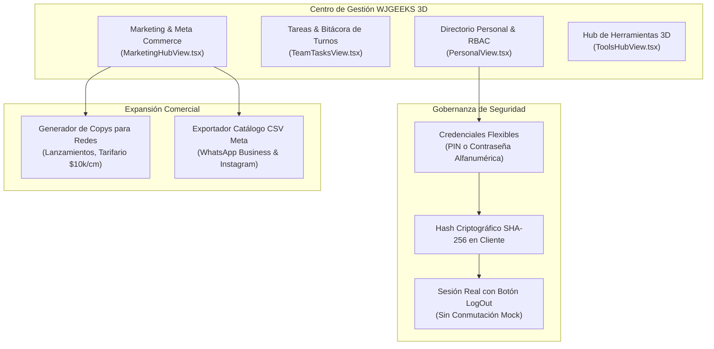
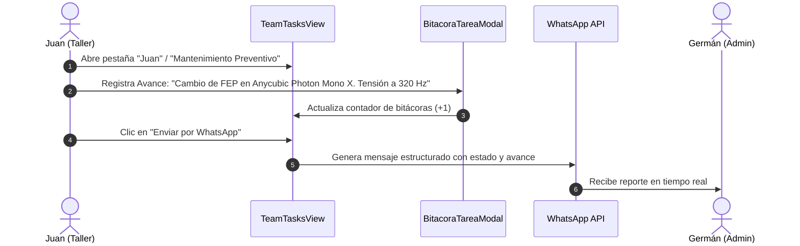

# WJGEEKS 3D PRO — Manual de Gestión, Personal y Administración
**Versión del Documento:** 3.0 Enterprise  
**Módulo:** Gestión de Equipo, Bitácora de Turnos, Directorio RBAC y Marketing Hub  
**Archivos Fuente Principales:** [`src/components/personal/PersonalView.tsx`](file:///d:/WJG/src/components/personal/PersonalView.tsx) | [`src/components/team/TeamTasksView.tsx`](file:///d:/WJG/src/components/team/TeamTasksView.tsx) | [`src/components/marketing/MarketingHubView.tsx`](file:///d:/WJG/src/components/marketing/MarketingHubView.tsx) | [`src/components/tools/ToolsHubView.tsx`](file:///d:/WJG/src/components/tools/ToolsHubView.tsx)  
**Fecha:** Octubre 2026  

---

## 1. Visión y Propósito del Módulo de Gestión

El módulo de **Gestión y Administración** conforma el núcleo directivo de WJGEEKS 3D PRO. Su misión es orquestar los recursos humanos, garantizar la seguridad del sistema mediante control de accesos basado en roles (*RBAC*), registrar la bitácora operativa de las máquinas e impulsar la tracción comercial a través de herramientas de marketing omnicanal.



---

## 2. Directorio de Personal y Control de Acceso (RBAC)

El archivo [`src/components/personal/PersonalView.tsx`](file:///d:/WJG/src/components/personal/PersonalView.tsx) administra la nómina de colaboradores y sus privilegios dentro de la plataforma.

### 2.1. Matriz de Roles Predefinidos
| Rol de Sistema | Identificador | Responsable Habitual | Privilegios y Áreas Autorizadas |
| :--- | :--- | :--- | :--- |
| **Admin & Cobranzas** | `ADMIN_COBRANZAS` | **Germán** | **Acceso Total (6 Áreas):** Cotizaciones, Taller, Finanzas, POS, Gestión de Personal, Configuración y Borrado de Registros. |
| **Pintura & Acabados** | `PINTURA_ACABADOS` | **Wendy** | **Áreas:** Taller (Columnas de Acabados), Finanzas (Registro de Abonos), POS Express, Bitácora y Tareas. |
| **Impresión & Slicer** | `IMPRESION_MANTENIMIENTO` | **Juan** | **Áreas:** Taller (En Cola, Imprimiendo, Curado), Mantenimiento de Máquinas, Trazabilidad STL y SOS Insumos. |
| **Ventas & Caja POS** | `VENTAS_POS` | **Mostrador** | **Áreas:** POS Express, Consulta de Precios y Tarifario de Altura. Sin acceso a borrado de cartera ni nómina. |

### 2.2. Sistema de Credenciales Flexibles (PIN o Clave Compleja)
Para adaptarse tanto a la agilidad requerida en un mostrador físico como a la exigencia de seguridad en accesos remotos móviles:
* Cada colaborador puede configurar indistintamente:
  * Un **PIN numérico rápido** (4 a 6 dígitos) para desbloqueo ágil en tablet de mostrador.
  * O una **contraseña alfanumérica compleja** (letras mayúsculas, minúsculas, números y símbolos) para acceso web seguro desde fuera del taller.
* **Cifrado SHA-256 en Cliente:** El sistema nunca envía ni almacena contraseñas en texto plano. La función `hashPin()` computa el digesto hexadecimal mediante la API estándar Web Crypto:
  ```typescript
  const msgUint8 = new TextEncoder().encode(pinOrPassword.trim());
  const hashBuffer = await crypto.subtle.digest('SHA-256', msgUint8);
  const hashHex = Array.from(new Uint8Array(hashBuffer))
    .map(b => b.toString(16).padStart(2, '0'))
    .join('');
  ```
* **Modal de Cambio de Clave (`CambiarPinModal.tsx`):** Permite al operador actualizar su propia credencial ingresando la clave actual y confirmando la nueva, o al Administrador restaurarla mediante código de reseteo.

### 2.3. Blindaje de Sesión y Eliminación de Conmutación Mock
Anteriormente, la cabecera permitía alternar de usuario haciendo clic sobre el nombre del operador. En la versión 3.0 Enterprise:
1. Se suprimió la conmutación mock en [`src/components/ui/HeaderMinimal.tsx`](file:///d:/WJG/src/components/ui/HeaderMinimal.tsx).
2. Se implementó un botón explícito de **Cerrar Sesión (`LogOut`)** que purga la sesión activa en `StaffAuthGuard.tsx`.
3. Se blindó la consulta de Supabase con validación de UUID canónico (`isUUID()`), resolviendo el error de tipos de Postgres en dispositivos móviles.

---

## 3. Tareas de Equipo y Bitácora de Turnos (`TeamTasksView.tsx`)

La continuidad operativa entre los relevos de Juan, Wendy y Germán se canaliza a través de dos herramientas sincronizadas en tiempo real:



### 3.1. Estructura de Tareas
Cada tarea cuenta con:
* **Asignado a:** Pestañas dedicadas para `Germán`, `Wendy`, `Juan`, `Todos` o `Periódicas`.
* **Nivel de Prioridad:** `ALTA` (Rojo), `MEDIA` (Ámbar) o `BAJA` (Azul).
* **Estado:** `Pendiente`, `En Progreso` o `Completada` (con animación de confeti para refuerzo de motivación de equipo).
* **Fecha Límite:** Alertas automáticas cuando la tarea entra en vencimiento.

### 3.2. Bitácora de Novedades y Mantenimiento de Equipos
Al pulsar el icono de libro en una tarea, se abre el modal [`BitacoraTareaModal.tsx`](file:///d:/WJG/src/components/team/BitacoraTareaModal.tsx):
* Permite redactar anotaciones técnicas con fecha, hora exacta y autor del turno.
* Historial de reemplazos: horas acumuladas de pantalla LCD, cambios de filtro de carbón activado, lubricación del eje Z con grasa de litio y roturas de resina.

### 3.3. Protocolo SOS Insumos (Compras de Emergencia)
* Si durante la noche se agota el alcohol isopropílico o los guantes de nitrilo, el operador crea una alerta **SOS Insumos**.
* El sistema categoriza la urgencia y genera un enlace instantáneo a WhatsApp dirigido a los compradores autorizados con la marca y cantidad requerida.

---

## 4. Hub de Marketing y Catálogo Meta Commerce (`MarketingHubView.tsx`)

Para acelerar las ventas sin requerir software de diseño adicional, el módulo incorpora:

### 4.1. Generador de Copywriting para Redes Sociales
Ofrece plantillas inteligentes prearmadas con emojis y variables en vivo:
1. **Lanzamiento / Nueva Figura:** Formatea post para Instagram con especificaciones técnicas, resolución 8K y enlace directo a WhatsApp.
2. **Tarifario Oficial ($10.000 COP / cm):** Comunica la tabla transparente de precios desde 5 cm ($50.000) hasta 12 cm ($120.000).
3. **Entrega Inmediata (Stock Mostrador):** Promueve piezas terminadas listas para despacho en el día.

### 4.2. Exportador de Catálogo CSV para Meta Commerce (WhatsApp Business e Instagram Shopping)
Genera con un solo clic el archivo `.csv` con la estructura oficial exigida por Meta:

```csv
id,title,description,availability,condition,price,link,image_link,brand
PROD-001,"Busto Spider-Man 12cm","Figura en resina UV 8K pintada a mano",in stock,new,50000 COP,https://wa.me/573503443140,https://i.imgur.com/spiderman.jpg,WJGEEKS 3D
PROD-002,"Figura Nezuko Chibi 7cm","Coleccionable en resina curada con base",in stock,new,40000 COP,https://wa.me/573503443140,https://i.imgur.com/nezuko.jpg,WJGEEKS 3D
```

Este archivo se sube directamente al *Commerce Manager* de Meta para habilitar las tiendas en Instagram y catálogos interactivos dentro del chat de WhatsApp de la empresa.

---

## 5. Hub de Herramientas y Repositorios 3D (`ToolsHubView.tsx`)

Centraliza accesos directos de alta frecuencia para el trabajo diario de modelado y laminado:
* **Slicers y Software 3D:** Chitubox Free/Pro, Lychee Slicer, PrusaSlicer, Meshmixer, Blender.
* **Bancos de Modelos 3D Autorizados:** Thingiverse, Cults3D, Printables, MakerWorld (Bambu Lab), CGTrader, Thangs.
* **Calculadoras Auxiliares:** Estimadores de resina y convertidores de mallas STL a OBJ/STEP.
