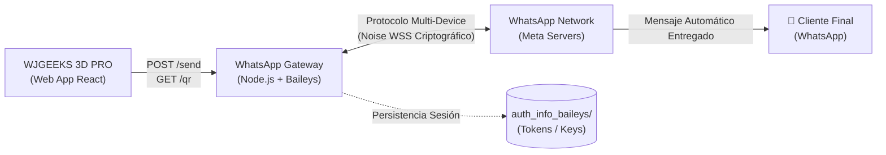
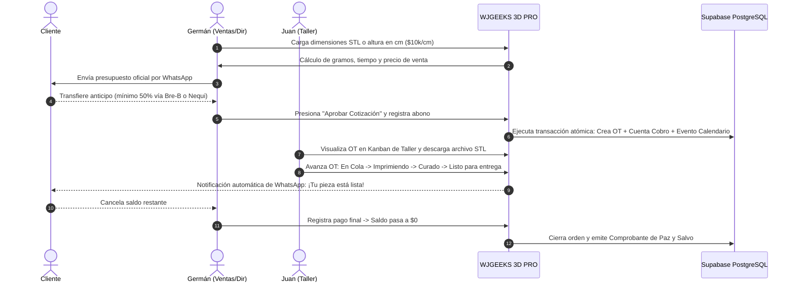

# Manual Oficial de Usuario y Operaciones del Sistema: WJGEEKS 3D PRO

**Versión:** 3.0 Enterprise (Master Schema v3)  
**Fecha de Actualización:** Octubre 2026  
**Autor:** Equipo de Arquitectura de Software & Tech Lead WJGEEKS 3D  
**Clasificación:** Documento Interno de Operación, Seguridad y Despliegue  

---

> [!TIP]
> ### 📚 Suite Modular de Manuales Operativos en la Carpeta `docs/`
> Para consultar el flujo detallado y la guía especializada de cada área, refiérase a la suite modular:
> - **[00. Ecosistema y Relación Intermodular](file:///d:/WJG/docs/00_ARQUITECTURA_Y_RELACION_INTERMODULAR.md):** Mapa relacional, ciclo de vida unificado y consistencia transaccional.
> - **[01. Manual del Cotizador y Motor de Cálculos](file:///d:/WJG/docs/01_MANUAL_COTIZADOR_Y_CALCULOS.md):** Las 20 variables paramétricas, fórmulas matemáticas y tarifario de $10.000/cm.
> - **[02. Manual del POS Express y Venta Mostrador](file:///d:/WJG/docs/02_MANUAL_POS_EXPRESS.md):** Compresión WebP en canvas, ventas de mostrador y semáforo de cobranza.
> - **[03. Manual de Taller y Flujo de Producción Kanban](file:///d:/WJG/docs/03_MANUAL_TALLER_Y_PRODUCCION.md):** Pipeline de 7 fases, regla de anticipo del 50%, trazabilidad STL y relevo de turno.
> - **[04. Manual de Finanzas, Cartera y Conciliación](file:///d:/WJG/docs/04_MANUAL_FINANZAS_Y_CARTERA.md):** Central de deudores, libro mayor multicanal y RPC atómica de limpieza de duplicados.
> - **[05. Manual de Gestión, Personal y Administración](file:///d:/WJG/docs/05_MANUAL_GESTION_Y_ADMINISTRACION.md):** Directorio RBAC, bitácora técnica de máquinas y catálogo Meta Commerce.

---

## 📑 Índice de Contenidos

1. [Directorio Oficial del Personal y UUIDs Canónicos](#1-directorio-oficial-del-personal-y-uuids-canónicos)
2. [Autenticación Blindada, Credenciales Flexibles y Gestión de Sesión](#2-autenticación-blindada-credenciales-flexibles-y-gestión-de-sesión)
   - [2.1 Modalidades de Clave: PIN Rápido vs Contraseña Compleja](#21-modalidades-de-clave-pin-rápido-vs-contraseña-compleja)
   - [2.2 Blindaje del Encabezado (Header Minimalista) y Cierre de Sesión](#22-blindaje-del-encabezado-header-minimalista-y-cierre-de-sesión)
   - [2.3 Soporte Multi-Dispositivo y Acceso Móvil Resiliente (Anti-22P02)](#23-soporte-multi-dispositivo-y-acceso-móvil-resiliente-anti-22p02)
   - [2.4 Flujo de Recuperación de Credenciales](#24-flujo-de-recuperación-de-credenciales)
   - [2.5 Administración de Colaboradores (PersonalView)](#25-administración-de-colaboradores-personalview)
3. [Módulo 1: Calendario Operativo Interactivo 100% Funcional](#3-módulo-1-calendario-operativo-interactivo-100-funcional)
4. [Módulo 2: Mensajería Desatendida por WhatsApp Business API](#4-módulo-2-mensajería-desatendida-por-whatsapp-business-api)
5. [Módulo 3: Arquitectura Supabase Master v3 y Vistas con Security Invoker](#5-módulo-3-arquitectura-supabase-master-v3-y-vistas-con-security-invoker)
   - [5.1 Principio de Security Invoker (Supabase Linter 0010)](#51-principio-de-security-invoker-supabase-linter-0010)
   - [5.2 Tablas del Ledger y Políticas RLS](#52-tablas-del-ledger-y-políticas-rls)
   - [5.3 Procedimientos Almacenados (RPCs) Transaccionales](#53-procedimientos-almacenados-rpcs-transaccionales)
6. [Módulo 4: Portal de Clientes Aislado y Confidencial](#6-módulo-4-portal-de-clientes-aislado-y-confidencial)
7. [Flujos Operativos Integrales de Negocio (Workflows Paso a Paso)](#7-flujos-operativos-integrales-de-negocio-workflows-paso-a-paso)
   - [Flujo A: Cotización ➔ Anticipo 50% ➔ Taller ➔ Liquidación](#flujo-a-cotización--anticipo-50--taller--liquidación)
   - [Flujo B: Venta Express POS Mostrador con Cámara WebP](#flujo-b-venta-express-pos-mostrador-con-cámara-webp)
   - [Flujo C: Cambio Seguro de Turno / Operador en Taller](#flujo-c-cambio-seguro-de-turno--operador-en-taller)
8. [Preguntas Frecuentes, Guía de Diagnóstico y Soporte](#8-preguntas-frecuentes-guía-de-diagnóstico-y-soporte)

---

## 1. Directorio Oficial del Personal y UUIDs Canónicos

El sistema WJGEEKS 3D PRO cuenta con un control de acceso basado en roles (RBAC) sincronizado de forma estricta con la tabla `public.usuarios_taller` en Supabase:

| Miembro del Personal | Identificador Canónico (UUID Supabase) | Rol RBAC | Áreas de Acceso | WhatsApp Oficial | Correo Electrónico |
| :--- | :--- | :--- | :--- | :--- | :--- |
| **Germán Reyes** | `08c6c49a-0422-414b-813e-8f58fa651bd5` | `ADMIN_COBRANZAS` (Director Global) | `ventas`, `taller`, `finanzas`, `gestion` | **+57 350 3443140** | `german@wjgeeks.com` |
| **Wendy Castro** | `4485aa21-3896-4510-b693-fc68e947372d` | `PINTURA_ACABADOS` (Cobranzas & Post) | `taller`, `gestion` | **+57 320 4814702** | `wendy@wjgeeks.com` |
| **Juan David Guzmán** | `a48df7ca-8b06-4bab-bfa4-3b058912b06f` | `IMPRESION_MANTENIMIENTO` (Taller 3D) | `taller` | **+57 321 7273025** | `juan@wjgeeks.com` |

> [!IMPORTANT]
> **Canal Exclusivo de Notificaciones y Seguridad:**  
> Todos los códigos OTP, recordatorios de mora, alertas de insumos (S.O.S) y comprobantes se enrutan exclusivamente a las líneas canónicas anteriores.

---

## 2. Autenticación Blindada, Credenciales Flexibles y Gestión de Sesión

### 2.1 Modalidades de Clave: PIN Rápido vs Contraseña Compleja
A partir de la versión 3.0, el sistema elimina las restricciones rígidas de contraseñas. Cada colaborador puede configurar la credencial que mejor se adapte a su forma de trabajo:

1. **PIN Numérico Rápido (4 o más dígitos):**
   - Diseñado para operadores en planta de impresión o tabletas táctiles con guantes de nitrilo.
   - Detectado automáticamente por la interfaz (`badge` azul: *"PIN Rápido"*).
2. **Contraseña Alfanumérica Compleja (Longitud variable >= 4 caracteres):**
   - Permite letras mayúsculas, minúsculas, números y símbolos especiales (ej: `WJG3rm4n2605@`).
   - Detectado automáticamente por la interfaz (`badge` morado: *"Contraseña Alfanumérica"*).
3. **Almacenamiento Criptográfico Seguro:**
   - En la base de datos PostgreSQL, la clave se persiste en formato texto en `pin_acceso` (ampliado a tipo `TEXT`), acompañado de su hash unidireccional SHA-256 en la columna `password_hash`.
   - La aplicación admite validación híbrida (comparación directa segura o verificación de hash criptográfico).

### 2.2 Blindaje del Encabezado (Header Minimalista) y Cierre de Sesión
Anteriormente existía un conmutador de pruebas en desarrollo que permitía alternar operadores haciendo clic sobre el nombre. **Este atajo ha sido completamente eliminado.**

- **Badge de Solo Lectura:** El indicador superior (`Sesión: Germán`) es estrictamente informativo. No conmuta de usuario ni escala privilegios al hacer clic.
- **Botón de Cambio de Clave / PIN (`KeyRound` - Icono de Llave):** Permite al operador activo abrir [`CambiarPinModal`](file:///d:/WJG/src/components/auth/CambiarPinModal.tsx) para actualizar su clave personal ingresando la clave actual y la nueva.
- **Botón de Salida Segura (`LogOut` - Icono de Puerta Roja):** 
  - Revoca inmediatamente la sesión activa y el dispositivo de confianza local.
  - Redirige al operador a la pantalla de guardia ([`StaffAuthGuard`](file:///d:/WJG/src/components/auth/StaffAuthGuard.tsx)).
  - **Obligatoriedad de Credenciales:** Para ingresar como otro usuario (por ejemplo, de Germán a Wendy), el nuevo operador **debe introducir obligatoriamente su PIN o contraseña**.

### 2.3 Soporte Multi-Dispositivo y Acceso Móvil Resiliente (Anti-22P02)
En dispositivos móviles sin sesiones previas (o al acceder desde una nueva pestaña de incógnito):
- Los selectores rápidos de perfil utilizan los UUIDs canónicos oficiales de Supabase (`08c6c49a-...`).
- El guardián ejecuta una consulta higienizada con la función `isUUID()`: si un identificador no cumple la expresión regular de UUID, filtra de forma segura por `nombre` y `email`, eliminando por completo el error de PostgreSQL `ERROR 22P02 (invalid input syntax for type uuid)`.
- Al validar credenciales con éxito contra la nube, se hidrata inmediatamente el almacenamiento local del teléfono (`wjg_usuarios_taller_cache`), asegurando que el celular pueda operar en modo fuera de línea si se interrumpe la conexión Wi-Fi en el taller.

### 2.4 Flujo de Recuperación de Credenciales
Si un colaborador olvida su contraseña o PIN:
1. **Recuperación Inmediata por Cédula y Teléfono:**
   - En [`StaffAuthGuard`](file:///d:/WJG/src/components/auth/StaffAuthGuard.tsx), pulsa sobre *"¿Olvidaste tu PIN o contraseña?"*.
   - Digita el número de cédula registrado (ej: `1098765432`) y el teléfono corporativo (`3503443140`).
   - El sistema valida la identidad contra `usuarios_taller` y permite ingresar una nueva clave de acceso inmediatamente.
2. **Recuperación por WhatsApp OTP:**
   - Mediante el servicio [`whatsappOtpService.ts`](file:///d:/WJG/src/services/whatsappOtpService.ts), se despacha un código numérico aleatorio de 6 dígitos con vigencia de 10 minutos a la línea del colaborador.

### 2.5 Administración de Colaboradores (`PersonalView`)
Accesible desde la sección de **Gestión** para usuarios con rol administrativo:
- **Alta de Nuevos Operadores:** Formulario interactivo con selector de áreas asignadas (`ventas`, `taller`, `finanzas`, `gestion`).
- **Campo de Clave con Visibilidad Alternable:** Icono de ojo (`Eye` / `EyeOff`) para verificar la clave o PIN asignado antes de guardar.
- **Despacho Automático de Bienvenida:** Botón *"Enviar WhatsApp de Bienvenida"* que redacta y abre una plantilla preformateada en WhatsApp con el enlace de la app, usuario, teléfono, áreas autorizadas y su clave de acceso inicial.
- **Kill Switch:** Interruptor para desactivar instantáneamente el acceso de cualquier cuenta comprometida.

---

## 3. Módulo 1: Calendario Operativo Interactivo 100% Funcional

El Calendario Operativo (`CalendarOperationalView`) consolida la agenda técnica y comercial del taller:
- **Vistas Soportadas:** Mes, Semana, Día y Agenda tipo feed.
- **Drawer Lateral de Desglose Diario:** Al presionar sobre cualquier celda de fecha, se abre un panel lateral con los compromisos clasificados en pendientes y completados.
- **Codificación Cromática:**
  - 🔴 **Vencimiento de Cobro (`#ef4444`):** Saldos de cartera con fecha límite.
  - 🔵 **Entrega de Orden de Trabajo (`#38bdf8`):** Compromisos de entrega de piezas impresas.
  - 👤 **Tarea Individual (`#f59e0b`):** Asignaciones específicas a Germán, Wendy o Juan.
  - 🔄 **Rutina Periódica (`#10b981`):** Mantenimiento de tanques FEP, filtrado de resina y respaldos.
- **Deep-Linking:** Hacer clic sobre un evento navega directamente a la Cuenta de Cobro o a la Orden de Trabajo técnica en el pipeline.

---

---

## 4. Módulo 2: Motor Gateway de WhatsApp Multi-Device y Mensajería Automática

El sistema cuenta con un motor unificado de mensajería desatendida y bidireccional vinculado a la línea oficial corporativa (**+57 320 2796115**).

### 4.1. Arquitectura: ¿Por qué el QR anterior no escaneaba y no salían mensajes?
- **Prototipo Anterior (Mock Demostrativo):** El servidor inicial contenía un generador SVG decorativo estático ("WJG") creado únicamente para validar la interfaz gráfica. Dado que no utilizaba el protocolo de enlace criptográfico de WhatsApp Web, la cámara de WhatsApp lo rechazaba como código no válido y las peticiones `/send` se limitaban a imprimir en consola sin transmisión real.
- **Implementación Actual (Motor Real Baileys):** Ahora el servidor incorpora `@whiskeysockets/baileys` y `qrcode`. Este motor negocia las claves públicas con los servidores WebSocket de WhatsApp, generando un **código QR criptográfico real de WhatsApp Web**. Al escanearlo, el celular lo registra oficialmente en *Dispositivos Vinculados* y cualquier llamada al endpoint `/send` despacha el mensaje inmediatamente al chat del cliente.

### 4.2. Paso a Paso para Vincular el WhatsApp Oficial
1. **Iniciar el Servidor Gateway:**
   - En tu PC: ejecuta `npm run wa:gateway`
   - O si usas el celular con Termux conectado por USB: ejecuta `npm run wa:phone`
2. **Abrir el Modal de Conexión en WJGEEKS 3D PRO:**
   - Haz clic en el botón de WhatsApp (esquina superior derecha de la aplicación).
   - Verás el código QR real generado por el motor en pantalla.
3. **Escanear desde el Celular Oficial (+57 320 2796115):**
   - Abre WhatsApp en el celular.
   - Ve a **Ajustes (o Menú ⋮) > Dispositivos vinculados > Vincular un dispositivo**.
   - Apunta la cámara del teléfono hacia el código QR en la pantalla de la PC.
4. **Confirmación Inmediata:**
   - El sistema detectará la sesión automáticamente y cambiará al estado **`Conectado`**.
   - Las credenciales se guardan de forma encriptada y persistente en la carpeta local `auth_info_baileys/`. **No tendrás que volver a escanear el QR** al reiniciar el computador.

### 4.3. Tipos de Notificaciones Despachadas al Cliente Final
1. **Cobranzas y Cartera:** Alerta matutina automática para cuentas de cobro con saldo pendiente o vencimiento en 48 horas, adjuntando la llave Bre-B (`0090778625`) y cuenta Nequi.
2. **Fin de Fabricación (Taller):** Notificación automática cuando una Orden de Trabajo pasa al estado `"Listo para entrega"`, con el balance liquidado y resumen de retiro en tienda.
3. **Comprobante de Abono / Anticipo:** Envío automático del recibo digital tras registrar un abono en el POS o módulo financiero.
4. **Fallback Automático Asistido:** Si el Gateway no estuviera encendido, el sistema conmuta automáticamente a la API directa (`wa.me`) abriendo el chat con la plantilla redactada para no interrumpir la atención.

### 4.4. Operación con Celular Autónomo (Termux & ADB)
Si deseas que el servidor funcione desde un teléfono Android secundario para no depender de tener la PC encendida:
- **Gestión Automatizada por USB:** Ejecuta `npm run wa:phone`. El script detecta el teléfono por ADB, verifica la versión de Node.js en Termux y redirige el puerto `3001` bidireccionalmente.
- **Acceso por Red Wi-Fi Local:** El celular expone el servicio en su IP interna (`http://192.168.1.9:3001`). En el modal de WJGEEKS > pestaña *Ajustes*, ingresa esta IP para operar de forma inalámbrica.
- **Mantenimiento en Segundo Plano:** El comando `termux-wake-lock` mantiene el proceso despierto incluso cuando la pantalla del celular se apaga.

---

## 5. Módulo 3: Arquitectura Supabase Master v3 y Vistas con Security Invoker

### 5.1 Principio de Security Invoker (Supabase Linter 0010)
Las vistas del sistema están configuradas con la propiedad `WITH (security_invoker = true)`:
- `public.vista_balance_taller`: Agrega en tiempo real ingresos por Nequi, Bre-B, Efectivo y saldo por cobrar.
- `public.payments`: Ledger consolidado de abonos y comprobantes.
- `public.cuentas_cobro`: Vista canónica de cartera comercial.

> [!NOTE]
> Al estar definidas como **`SECURITY INVOKER`**, PostgreSQL evalúa las políticas RLS del usuario que realiza la consulta, garantizando que un cliente externo nunca pueda ver balances globales y resolviendo al 100% las advertencias del Database Linter de Supabase.

### 5.2 Tablas del Ledger y Políticas RLS
Todas las tablas cuentan con Row Level Security activado (`ENABLE ROW LEVEL SECURITY`) con políticas explícitas:
- `usuarios_taller`: Directorio y credenciales.
- `clientes` & `cotizaciones` & `cotizacion_items`: Área comercial.
- `ordenes_trabajo` & `historial_estados_ot`: Taller de manufactura 3D.
- `abonos_pagos`: Ledger contable inmutable con trazabilidad a POS y Cuentas de Cobro.
- `productos_stock` & `ventas_express`: Inventario físico y ventas de mostrador.

### 5.3 Procedimientos Almacenados (RPCs) Transaccionales
- `fn_cambiar_pin_usuario`: Cambio atómico de clave o PIN con recálculo de hash SHA-256 en base de datos.
- `fn_eliminar_cobro_duplicado`: Eliminación segura de un registro de abono con recálculo automático del saldo en la orden de trabajo correspondiente.
- `fn_validar_reglas_anticipo_y_entrega`: Trigger que bloquea el paso de una OT a fases de impresión o curado si el abono registrado es inferior al **50%**.

---

## 6. Módulo 4: Portal de Clientes Aislado y Confidencial

- **Ruta de Acceso:** Enlace único parametrizado con token criptográfico (ej: `https://wjgeeks3d.com/?ot=OT-0001&token=uuid`).
- **Aislamiento Total:** El portal detecta el modo cliente y oculta todas las barras de navegación, botones de login administrativo y costos de resina.
- **Barra de Progreso:** Representación visual de 6 etapas (*Recepción ➔ Preparación STL ➔ Impresión 3D ➔ Curado UV ➔ Acabados & Pintura ➔ ¡Listo para Entrega!*).
- **Garantía de Saldo:** Si la pieza está totalmente pagada y lista, la barra refleja el 100% de cumplimiento.

---

## 7. Flujos Operativos Integrales de Negocio (Workflows Paso a Paso)

### Flujo A: Cotización ➔ Anticipo 50% ➔ Taller ➔ Liquidación

### Flujo B: Venta Express POS Mostrador con Cámara WebP
1. El cliente escoge una figura exhibida en el taller o feria.
2. El operario abre **Ventas Express (POS)**, pulsa el botón de la cámara y toma una foto de la pieza.
3. El motor del navegador comprime la foto a formato WebP ultraligero.
4. Selecciona el chip de valor rápido (ej: `$80.000`) e ingresa el anticipo entregado.
5. Si queda saldo pendiente, selecciona la fecha prometida de pago (*Fin de semana*, *15 días*, etc.).
6. Al presionar **"Registrar Venta Express"**:
   - Se guarda la venta en `ventas_express`.
   - Si se marcó descontar stock, se disminuye automáticamente la unidad en `productos_stock`.
   - Se registra el abono en el ledger contable `abonos_pagos`.
   - Se abre el enlace directo a WhatsApp con el recibo digital con emojis listo para enviar al comprador.

### Flujo C: Cambio Seguro de Turno / Operador en Taller
1. El operador que entrega el turno (ej. Germán) pulsa el botón rojo **Cerrar Sesión (`LogOut`)** en la esquina superior derecha.
2. El sistema revoca la sesión local y regresa a la pantalla de guardia [`StaffAuthGuard`](file:///d:/WJG/src/components/auth/StaffAuthGuard.tsx).
3. El operador que recibe el turno (ej. Wendy o Juan) selecciona su perfil en la pantalla táctil o escribe su número de teléfono.
4. Digita su PIN numérico o contraseña personal.
5. El sistema valida las credenciales y carga el espacio de trabajo con los permisos RBAC exactos del nuevo operador.

---

## 8. Preguntas Frecuentes, Guía de Diagnóstico y Soporte

| Situación / Pregunta | Causa Técnica | Solución Inmediata |
| :--- | :--- | :--- |
| **En el celular me decía "clave incorrecta" tras cambiarla en el PC** | El perfil móvil enviaba un ID no UUID (`id.eq.german`), disparando el error Postgres `22P02`. | **Solucionado en v3.0.** Actualiza la app en el celular. Los perfiles ahora utilizan UUIDs canónicos y validación segura `isUUID()`. |
| **Error `42601 syntax error at or near DECLARE` en Supabase** | Se intentó ejecutar un script de base de datos teniendo texto sombreado con el mouse ("Run selected"). | Abre una pestaña **NUEVA** en el SQL Editor de Supabase, asegúrate de no tener texto sombreado y presiona **Run**. |
| **Advertencia `security_definer_view` en el linter de Supabase** | Vistas creadas sin la opción `WITH (security_invoker = true)`. | Ejecuta: `ALTER VIEW public.vista_balance_taller SET (security_invoker = true);` (incluido en la migración 4). |
| **¿Cómo recupero mi clave si no recuerdo el PIN?** | Olvido de credenciales de operador. | En la pantalla de login pulsa *"¿Olvidaste tu PIN?"*, digita tu cédula y teléfono corporativo para definir una nueva clave al instante. |

---

  
<strong>WJGEEKS 3D PRO — Excelencia Técnica en Manufactura Aditiva</strong>

  
Soporte Oficial & Mesa de Ayuda: <code>+57 320 279 6115</code> • Bogotá D.C., Colombia

