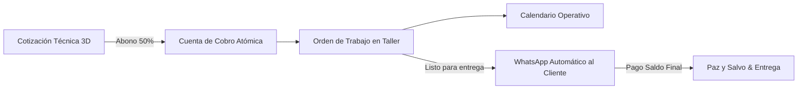

# Manual Oficial de Usuario y Operaciones del Sistema: WJGEEKS 3D PRO

**Versión:** 2.0 Enterprise  
**Fecha de Publicación:** Octubre 2026  
**Autor:** Equipo de Arquitectura de Software & Tech Lead WJGEEKS 3D  
**Clasificación:** Documento Interno de Operación y Seguridad  

---

## 1. Directorio Oficial del Personal y Roles de Acceso

El sistema WJGEEKS 3D PRO cuenta con control de acceso por roles y notificaciones directas a los números canónicos autorizados de la empresa:

| Miembro del Personal | Rol en el Sistema | Especialidad Operativa | WhatsApp Oficial | Correo Electrónico |
| :--- | :--- | :--- | :--- | :--- |
| **Germán Reyes** | `admin` (Administrador Global) | Dirección, Modelado 3D, Tarifarios y Control Maestro | **350 3443140** | `german@wjgeeks.com` |
| **Wendy Castro** | `cobranzas` (Administración / Finanzas) | Cartera, Cuentas de Cobro, Conciliación y Compras | **320 4814702** | `wendy@wjgeeks.com` |
| **Juan David Guzmán** | `taller` (Producción & Impresión 3D) | Cola de Fabricación, Postprocesado, Curado y S.O.S Insumos | **321 7273025** | `juan@wjgeeks.com` |

> [!IMPORTANT]
> **Canal Exclusivo de Notificaciones:** Todos los códigos de seguridad OTP, recordatorios de cobro y alertas de producción del sistema se emiten exclusivamente a los números anteriores. No se admiten números alternativos sin previa autorización del Administrador Global.

---

## 2. Acceso al Sistema y Persistencia "Minuto Cero"

### 2.1 Modalidades de Inicio de Sesión
La plataforma cuenta con una pantalla de autenticación blindada (`StaffAuthGuard`) accesible desde el botón superior **Staff** o al ingresar a rutas internas:

1. **Método 1: Selector de Perfil Rápido (Taller & Móviles Habituales):**
   - Haz clic sobre tu tarjeta de perfil (Germán, Wendy o Juan).
   - Ingresa tu clave o PIN numérico.
   - El sistema valida el hash criptográfico SHA-256 en milisegundos.
2. **Método 2: Entrada Dual (Correo o Teléfono de WhatsApp):**
   - Diseñado para cuando no se desea desplegar perfiles predefinidos.
   - Ingresa tu correo (ej: `wendy@wjgeeks.com`) o tu número de WhatsApp (ej: `3204814702`).
   - Ingresa tu contraseña y presiona **Ingresar al Sistema**.

### 2.2 Dispositivos de Confianza (Persistencia de 30 Días)
Para evitar tener que escribir la contraseña cada vez que abras la aplicación en tu celular habitual del taller o en tu computador de trabajo:
- Marca la casilla **"Recordar este dispositivo por 30 días (Dispositivo Seguro)"** antes de presionar Entrar.
- El sistema registrará una sesión segura persistente ("Minuto Cero"), permitiéndote cerrar el navegador, apagar el dispositivo o recargar la página sin perder el acceso.
- Si utilizas un computador público o ajeno, **desmarca** esta casilla para que la sesión expire al cerrar la pestaña.

### 2.3 Recuperación de Contraseña Vía WhatsApp OTP (6 Dígitos)
Si olvidaste tu clave o necesitas restablecerla de emergencia:
1. En la pantalla de login, presiona el enlace **"¿Olvidaste tu contraseña o necesitas recuperarla? Restablecer por WhatsApp"**.
2. Digita tu correo corporativo o tu número de teléfono registrado (Germán: `3503443140`, Wendy: `3204814702`, Juan: `3217273025`).
3. El backend generará un código OTP numérico de **6 dígitos** criptográficamente seguro y lo enviará de inmediato a tu WhatsApp.
4. **Vigencia:** El código tiene una ventana de validez estricta de **10 minutos**.
5. Ingresa el código en el modal y escribe tu nueva contraseña. El sistema cuenta con un medidor de fortaleza en tiempo real (mínimo 8 caracteres, mayúscula, número y símbolo).
6. Al presionar **Actualizar Contraseña**, tus credenciales quedarán renovadas en Supabase y podrás iniciar sesión al instante.

### 2.4 Gestión de Usuarios y Kill Switch (`UsuariosManagerView`)
Desde la pestaña **Personal** (accesible en la barra superior o en el menú móvil):
- Los administradores pueden visualizar la lista de personal activo, su rol y su última fecha de conexión.
- **Creación de nuevos usuarios:** Genera contraseñas provisionales seguras y fuerza el cambio de clave en el primer inicio de sesión (`must_change_password`).
- **Kill Switch (Interruptor de Bloqueo Inmediato):** En caso de pérdida de un celular o desvinculación de personal, desactiva el switch del usuario para revocar instantáneamente todas sus sesiones activas en todos los dispositivos.

---

## 3. Módulo 1: Calendario Operativo Interactivo 100% Funcional

El Calendario Operativo (`CalendarOperationalView`) centraliza todos los eventos de producción, finanzas y mantenimiento en un único cronograma reactivo.

### 3.1 Controles de Navegación y Vistas Dinámicas
En la cabecera del calendario encontrarás:
- **Vistas Disponibles:**
  - **Mes:** Panorama global de carga de trabajo mensual con cuadrícula de 35 a 42 días.
  - **Semana:** Distribución horaria y diaria detallada de lunes a domingo.
  - **Día:** Enfoque ultra detallado por horas de la jornada actual.
  - **Agenda:** Lista cronológica secuencial tipo feed de los próximos eventos ordenados por fecha y hora.
- **Navegación Temporal:** Flechas de avance y retroceso mes a mes y día a día.
- **Botón "Hoy":** Regresa inmediatamente a la fecha actual con un solo clic.
- **Filtros Avanzados:** Filtra en tiempo real por responsable (Germán, Wendy, Juan, Todos), por tipo de evento o por estado (Pendiente, Completado, Vencido).

### 3.2 Interacción y Desglose por Día (Drill-Down Drawer)
- **Apertura de la Ficha Diaria:** Al hacer clic sobre cualquier celda de fecha en la vista mensual, o sobre el indicador interactivo `+X más`, se despliega un **panel lateral (Drawer)** desde la derecha.
- **Desglose Cronológico:** El drawer lista de forma ordenada todas las entregas de OT, cobros de cartera, tareas personales y rutinas de mantenimiento programadas para ese día específico.
- **Filtro Rápido:** Dentro del drawer puedes filtrar rápidamente entre eventos pendientes y completados.

### 3.3 Codificación Cromática Inteligente
Cada evento se dibuja con una paleta cromática de alto contraste para identificación visual inmediata:

| Tipo de Evento | Color / Borde | Icono | Descripción Operativa |
| :--- | :--- | :---: | :--- |
| **Vencimiento de Cobro** | Rojo Neón (`#ef4444`) | 💰 | Cuentas de cobro o saldos pendientes con fecha límite de pago a clientes. |
| **Entrega de Pedido (OT)** | Azul Cian (`#38bdf8`) | 📦 | Órdenes de trabajo terminadas o con compromiso de entrega en taller. |
| **Tarea Individual** | Ámbar (`#f59e0b`) | 👤 | Tareas asignadas a una persona específica (Germán, Wendy o Juan). |
| **Tarea Grupal / Taller** | Púrpura (`#a855f7`) | 👥 | Actividades que involucran a todo el equipo o mantenimiento mayor. |
| **Rutina Diaria / Periódica** | Verde Esmeralda (`#10b981`) | 🔄 | Limpieza de cubas, calibración de impresoras, respaldos y revisión de stock. |
| **Llegada de Insumos** | Rosa Magenta (`#ec4899`) | 🛒 | Reabastecimiento de resinas UV, alcohol isopropílico, filtros o repuestos. |
| **Vencimiento de Cotización**| Gris Slate (`#94a3b8`) | 📄 | Cotizaciones comerciales pendientes de respuesta o anticipo del cliente. |

### 3.4 Deep-Linking (Navegación Directa al Registro Exacto)
Cada evento en el calendario es un enlace directo al registro original:
- Al hacer clic en un evento de **Cobro**, el sistema te redirige a la **Cuenta de Cobro** exacta en la pestaña *Cobros* para registrar abonos o emitir paz y salvo.
- Al hacer clic en una **Entrega de Pedido**, el sistema abre la **Orden de Trabajo (OT)** correspondiente en el *Workflow Pipeline*.
- Al hacer clic en una **Tarea de Equipo**, se abre la gestión de tareas en *Equipo*.
- **Reprogramación Rápida:** Puedes reprogramar cualquier fecha directamente desde el modal del evento; la nueva fecha se sincroniza automáticamente con la OT o Cuenta de Cobro en la base de datos Supabase.

---

## 4. Módulo 2: Mensajería Desatendida por WhatsApp (Cero Intervención Manual)

El sistema integra un motor de despacho automatizado y desatendido conectado a la API de WhatsApp Business Cloud de Meta.

### 4.1 Disparos Automáticos en Backend
1. **Cobranzas y Cartera:**
   - Una rutina en base de datos evalúa diariamente las cuentas de cobro con saldo pendiente.
   - Si una cuenta está a 48 horas de vencer o ya está vencida, el sistema encola automáticamente un mensaje personalizado con el nombre del cliente, número de cuenta de cobro, saldo pendiente y enlace de pago.
2. **Alertas de Órdenes de Trabajo (Taller):**
   - Cuando el operario de taller cambia el estado de una OT a **"Listo para entrega"**, el sistema genera y envía una notificación automática al WhatsApp del cliente informándole que su pieza 3D está lista para retiro o despacho.
3. **Recuperación de Contraseña OTP:**
   - Emisión desatendida del código de 6 dígitos con expiración de 10 minutos.

### 4.2 Auditoría e Idempotencia (`whatsapp_notification_logs`)
- Para evitar que un cliente o miembro del equipo reciba mensajes duplicados, cada envío genera una clave de idempotencia única (`idempotency_key`, por ejemplo: `cobro-cc-102-2026-10-21`).
- La tabla registra el estado en tiempo real: `queued` (en cola), `sent` (enviado), `delivered` (entregado) o `failed` (fallido).
- Cuenta con un mecanismo de reintento automático de hasta 3 intentos con retroceso exponencial.

---

## 5. Módulo 3: Sincronización Multi-Dispositivo en Tiempo Real

### 5.1 Fuente de la Verdad Unificada
- Toda la información mostrada en pantalla proviene en vivo de la base de datos PostgreSQL en Supabase.
- Se eliminaron todos los datos estáticos de prueba (mocks). Lo que ves en tu teléfono es exactamente lo que el equipo en el taller está registrando en la computadora de producción.

### 5.2 Supabase Realtime (`postgres_changes`)
- Las tablas críticas (`ordenes_trabajo`, `cuentas_cobro`, `cotizaciones`, `ventas_express`, `calendar_events`) tienen activado `REPLICA IDENTITY FULL`.
- Si Wendy registra un abono en contabilidad, la cuenta de cobro y el saldo se actualizan en el teléfono de Germán y de Juan **en tiempo real, sin recargar la página**.
- Si Juan avanza una OT en el taller de "Imprimiendo" a "Curado", el tablero Kanban y el calendario se mueven al instante en todos los dispositivos conectados.

### 5.3 Portal de Clientes Aislado y Seguro (`/seguimiento/[token]`)
- Los clientes acceden a su pedido a través de un enlace público único con token criptográfico (ej: `https://wjgeeks3d.com/?ot=OT-104&token=abc123xyz`).
- **Aislamiento Total:** El portal para clientes es estrictamente de **solo lectura**.
- **Seguridad Garantizada:** En esta vista no existen botones de inicio de sesión de personal, menús administrativos, márgenes de ganancia ni costos internos de resina.
- El cliente puede ver el avance de su pieza en una barra de progreso de 6 fases y presionar un botón para contactar al WhatsApp de soporte de WJGEEKS.

---

## 6. Flujo Operativo Integral de Negocio (Paso a Paso)

1. **Cotización Técnica (`Cotizador 3D`):**
   - Sube el archivo STL o ingresa los gramos de resina y dimensiones.
   - El motor calcula costo de resina UV, desgaste de máquina, insumos de curado/limpieza, mano de obra y margen de ganancia.
   - Guarda la cotización con datos del cliente.
2. **Aprobación y Creación de Cuenta de Cobro (`Cotizaciones`):**
   - Cuando el cliente aprueba el presupuesto, presiona **"Aprobar Cotización"**.
   - Ingresa el abono inicial (por ejemplo, 50%).
   - El sistema ejecuta la transacción atómica `approve_quote_and_settle`:
     - Genera automáticamente la Cuenta de Cobro (`CC-XXX`) con el saldo restante.
     - Crea la Orden de Trabajo (`OT-XXX`) en el taller.
     - Agenda la fecha de entrega en el Calendario Operativo.
3. **Producción en Taller (`Pipeline Workflow`):**
   - Juan visualiza la OT en el Kanban y asigna la máquina correspondiente.
   - Avanza las etapas: *En Cola -> Imprimiendo -> Lavado & Curado -> Control de Calidad -> Listo para entrega*.
4. **Entrega y Liquidación (`Cobros`):**
   - Al marcar "Listo para entrega", se notifica al cliente por WhatsApp.
   - Al recibir el saldo final, se registra el pago en *Cuentas de Cobro*, emitiendo el comprobante oficial y cerrando la orden.

---

## 7. Preguntas Frecuentes y Soporte Técnico

- **¿Qué hago si no recibo el código OTP por WhatsApp?**
  Verifica que hayas ingresado tu número oficial exactamente como está registrado (`3503443140`, `3204814702` o `3217273025`). Asegúrate de que tu celular tenga señal de datos e inténtalo nuevamente tras 60 segundos.
- **¿Cómo cambio la fecha de entrega de un pedido?**
  Entra al **Calendario**, busca el evento de la OT, pulsa sobre él, selecciona la nueva fecha y guarda. La orden de trabajo en el taller actualizará su fecha de entrega automáticamente.
- **¿Es seguro dejar la sesión abierta en mi celular?**
  Sí, siempre que tu teléfono personal cuente con bloqueo de pantalla por huella, PIN o reconocimiento facial. Si extravías tu equipo, solicita inmediatamente al Administrador que active el **Kill Switch** de tu usuario en la sección *Personal*.
